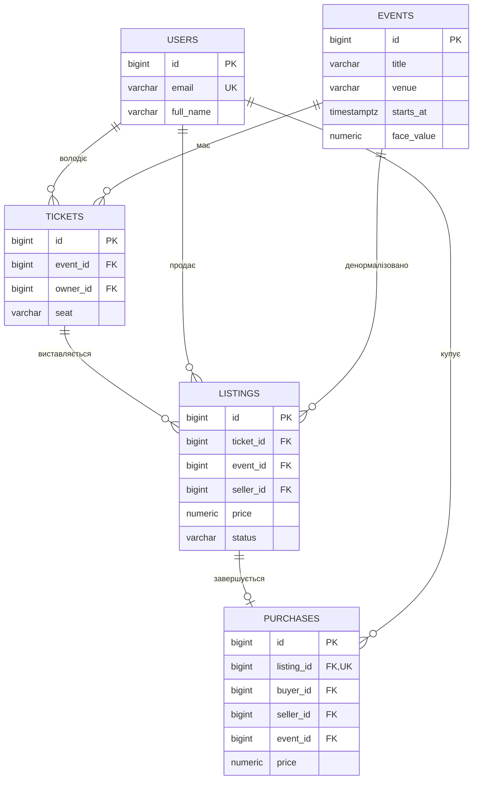
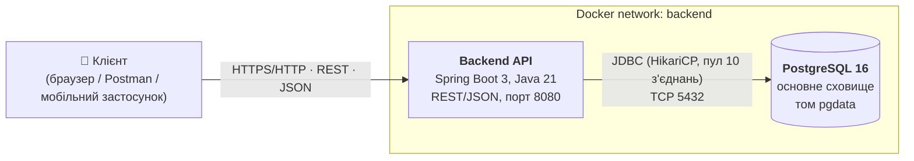
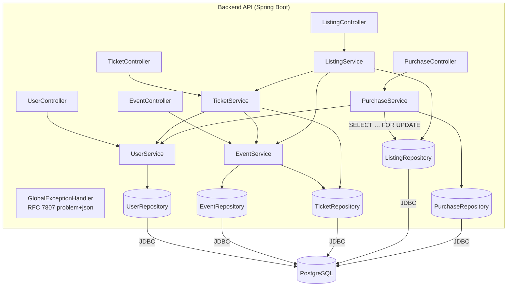
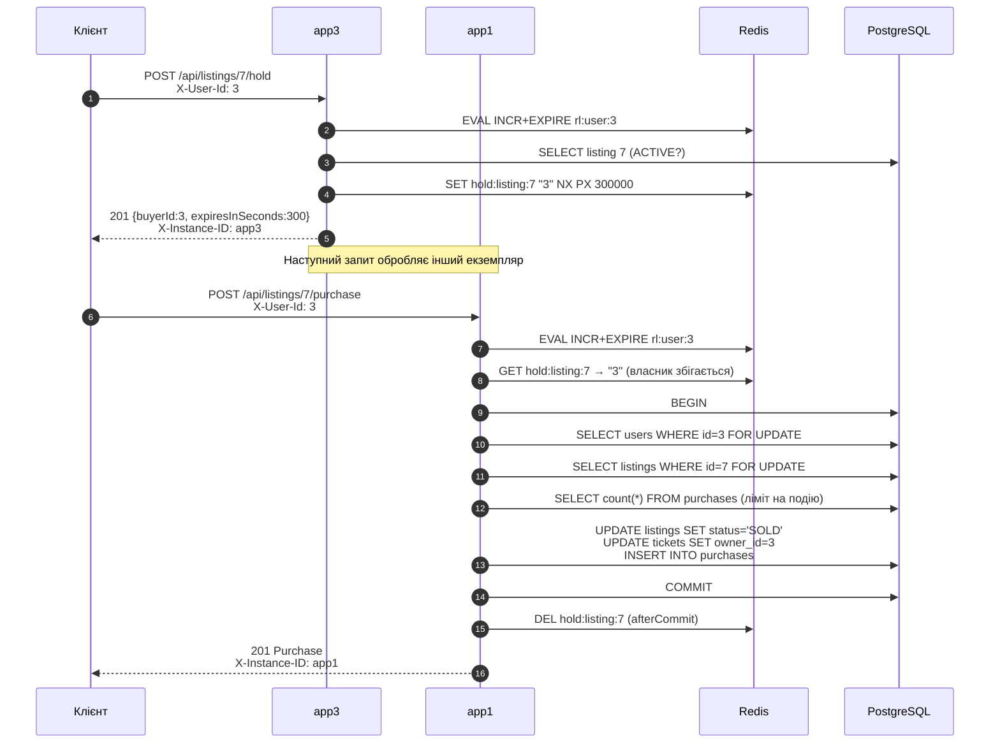
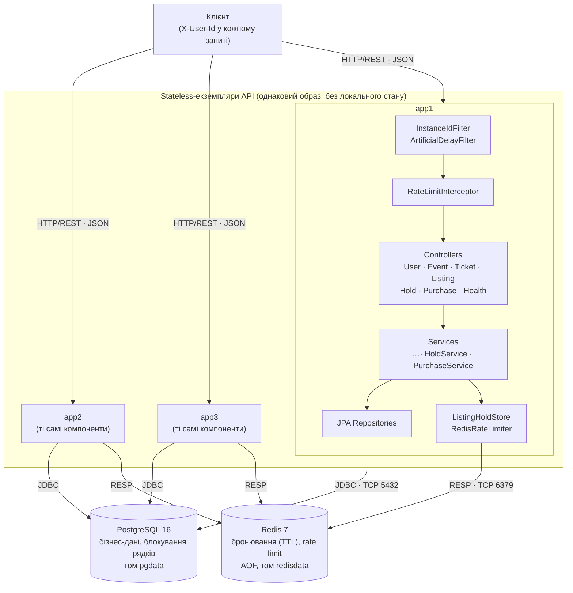
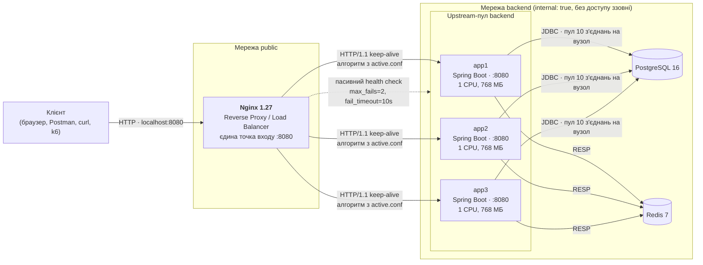
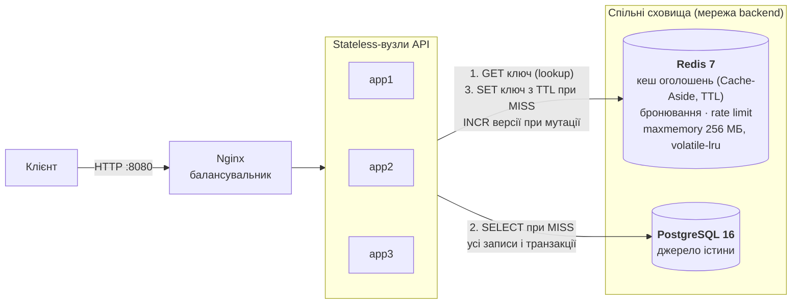
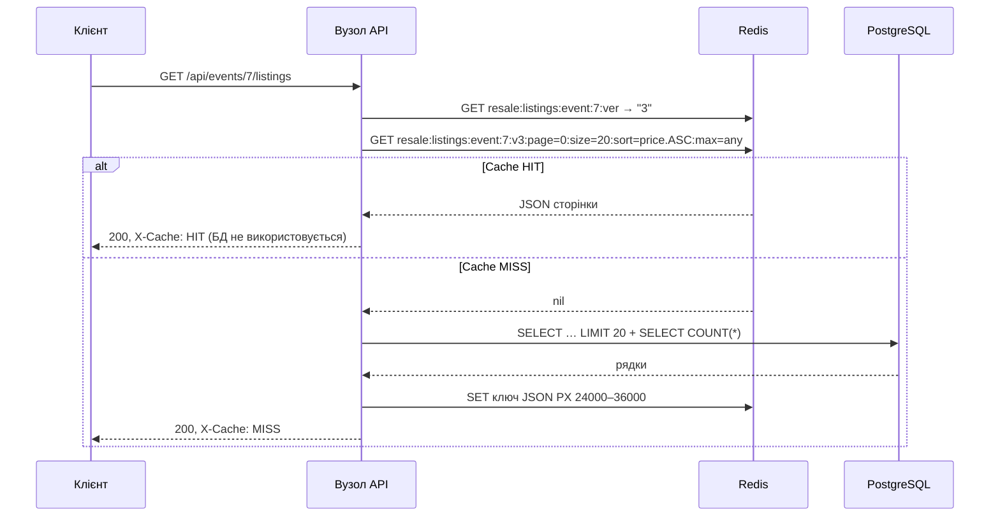

# Ticket Resale — платформа перепродажу квитків

Лабораторні роботи № 1–5: проєктування архітектури та базовий прототип (ЛР1), архітектура без стану (ЛР2), горизонтальне масштабування та балансування навантаження (ЛР3), розподілене кешування (ЛР4), навантажувальне тестування та Performance Baseline (ЛР5).

Платформа дозволяє власникам квитків виставляти їх на перепродаж, а покупцям — бронювати й купувати квитки на події. Ціна перепродажу обмежена (не більше +20% до номіналу), кількість квитків на одну подію для одного покупця обмежена (4 шт.), частота бронювань і купівель обмежена (20 на хвилину на користувача) — для протидії ботам і масовому скуповуванню.

**Стек:** Java 21, Spring Boot 3.3, Spring Data JPA (Hibernate 6), PostgreSQL 16, Redis 7, Flyway, Nginx 1.27, Docker Compose, k6, springdoc-openapi.

**Зміст**

1. [Запуск](#1-запуск)
2. [Доменна модель](#2-доменна-модель) · 3. [Архітектура](#3-архітектура) · 4. [API](#4-api) · 5. [High-Load Scenario](#5-піковий-сценарій-навантаження-high-load-scenario) · 6. [Bottleneck Analysis](#6-аналіз-потенційних-вузьких-місць-bottleneck-analysis) — ЛР1
7. [ЛР2. Архітектура без стану](#7-лр2-архітектура-без-стану-stateless)
8. [ЛР3. Горизонтальне масштабування та балансування](#8-лр3-горизонтальне-масштабування-та-балансування-навантаження)
9. [ЛР4. Розподілене кешування](#9-лр4-розподілене-кешування-distributed-caching)
10. [ЛР5. Навантажувальне тестування та Performance Baseline](#10-лр5-навантажувальне-тестування-та-performance-baseline)
11. [Структура репозиторію](#11-структура-репозиторію) · 12. [RACI](#12-розподіл-відповідальності-raci)

---

## 1. Запуск

Потрібно: Docker з плагіном Compose (Docker Desktop або Docker Engine), 4+ ядра CPU і 6+ ГБ RAM для повного стеку з трьома екземплярами. Демонстраційні скрипти — bash (Linux, macOS або Git Bash у Windows).

```bash
git clone https://github.com/<акаунт>/concert-ticket-system.git
cd concert-ticket-system
docker compose up -d --build
```

Команда піднімає PostgreSQL, Redis, три екземпляри API (`app1`, `app2`, `app3`) і балансувальник Nginx. Nginx стартує лише після того, як усі екземпляри пройшли healthcheck (≈ 40–60 с).

| Ресурс | Адреса |
|---|---|
| API (єдина точка входу — Nginx) | http://localhost:8080/api |
| Health check екземпляра | http://localhost:8080/health |
| Swagger UI | http://localhost:8080/swagger-ui.html |
| OpenAPI JSON | http://localhost:8080/v3/api-docs |

Назовні опубліковано лише порт балансувальника. Екземпляри API, PostgreSQL і Redis доступні тільки у внутрішній мережі `backend` (див. [8.2](#82-єдина-точка-входу-та-інкапсуляція-мережі)).

Схема БД і демо-дані створюються автоматично міграціями Flyway (`src/main/resources/db/migration`) під час старту застосунку. При одночасному старті кількох екземплярів міграцію виконує лише один: Flyway бере advisory lock PostgreSQL.

Зупинка: `docker compose down` (дані зберігаються в томах `pgdata` і `redisdata`). Повне очищення разом з даними: `docker compose down -v`.

### Перевірка збереження даних (persistence)

```bash
# 1. Створити користувача
curl -X POST localhost:8080/api/users -H "Content-Type: application/json" \
     -d '{"email":"test@example.com","fullName":"Тестовий Користувач"}'
# 2. Перезапустити контейнер БД
docker compose restart postgres
# 3. Переконатися, що запис на місці (id з кроку 1)
curl localhost:8080/api/users/4
```

Дані зберігаються в іменованому томі `pgdata`, змонтованому в `/var/lib/postgresql/data`.

### Демонстраційні скрипти

| Скрипт | Робота | Що демонструє |
|---|---|---|
| `scripts/lab2-cross-instance.sh` | ЛР2 | Ланцюжок запитів через різні екземпляри без sticky sessions; спільний rate limit |
| `scripts/lab2-instance-loss.sh` | ЛР2 | Аварійна зупинка екземпляра посеред бізнес-сценарію |
| `scripts/lab3-distribution.sh [N]` | ЛР3 | Розподіл N запитів за `X-Instance-ID` для активного алгоритму |
| `scripts/lb-switch.sh <профіль>` | ЛР3 | Live-переключення алгоритму балансування (reload без простою) |
| `scripts/lab3-slow-node.sh [мс]` | ЛР3 | Повільний вузол: Round Robin проти Least Connections |
| `scripts/lab3-failover.sh [stop\|kill]` | ЛР3 | Зупинка вузла під навантаженням, перевірка відсутності 5xx |
| `scripts/lab3-scale.sh` | ЛР3 | Scale-out: пропускна здатність для 1, 2, 3 вузлів |
| `scripts/lab4-cache-demo.sh` | ЛР4 | Cache MISS/HIT, холодні проти гарячих запитів, інвалідація, відмова Redis |
| `scripts/lab5-run-all.sh` | ЛР5 | Повний прогін: специфікація середовища, сценарії A/B/C, вплив кешу та масштабування |
| `scripts/lab5-environment.sh` | ЛР5 | Фіксація конфігурації тестового середовища |
| `scripts/lab5-cache-impact.sh` | ЛР5 | Cache Disabled проти Warm Cache під навантаженням |
| `scripts/lab5-scaling.sh` | ЛР5 | Scaling Efficiency Factor для 1, 2, 3 вузлів |

Скрипти навантаження запускають k6 у контейнері (окремо встановлювати не потрібно); результати зберігаються в каталозі `results/`.

---

## 2. Доменна модель

| Сутність | Призначення |
|---|---|
| **User** | Користувач платформи: і продавець, і покупець |
| **Event** | Подія (концерт, фестиваль) з номінальною ціною квитка `face_value` |
| **Ticket** | Конкретний квиток (місце) на подію, має поточного власника |
| **Listing** | Оголошення про перепродаж квитка: ціна, статус `ACTIVE / SOLD / CANCELLED` |
| **Purchase** | Факт купівлі: фіксує ціну, продавця, покупця й подію на момент угоди |



Обмеження цілісності на рівні БД:

- `UNIQUE (event_id, seat)` у `tickets` — одне місце на подію існує лише раз;
- частковий унікальний індекс `ux_listings_active_ticket ON listings(ticket_id) WHERE status='ACTIVE'` — квиток не може мати двох активних оголошень одночасно;
- `UNIQUE (listing_id)` у `purchases` — одне оголошення продається лише один раз;
- `CHECK` на додатні ціни та допустимі статуси.

---

## 3. Архітектура

Обрано **модульний моноліт** з шаровою архітектурою (Controller → Service → Repository). Код розділено на модулі за бізнес-можливостями (`user`, `event`, `ticket`, `listing`, `purchase`), а не за технічними шарами. Модулі взаємодіють лише через сервіси один одного, тому кожен з них за потреби можна виділити в окремий мікросервіс без переписування бізнес-логіки.

Обґрунтування: для MVP мікросервіси додали б мережеві виклики та розподілені транзакції там, де вони не потрібні. Найкритичніша операція — купівля — має бути атомарною (оголошення → SOLD, квиток → новому власнику, запис покупки), що просто забезпечується однією локальною ACID-транзакцією PostgreSQL.

### Діаграма контейнерів (C4, рівень Container) — базовий прототип ЛР1

Актуальна схема з балансувальником і кількома екземплярами — у [8.1](#81-архітектура-з-балансувальником-c4-рівень-container).



### Діаграма компонентів Backend API (C4, рівень Component)



Зовнішніх інтеграцій і черг повідомлень на етапі ЛР1 немає. Потенційні точки розширення: платіжний шлюз, сповіщення email (через чергу RabbitMQ/Kafka), кеш Redis для каталогу подій. Redis додано в ЛР2 як спільне сховище бронювань і лічильників rate limit (див. [7](#7-лр2-архітектура-без-стану-stateless)).

---

## 4. API

Повна специфікація — у Swagger UI. Поточний користувач передається заголовком `X-User-Id` (заглушка замість автентифікації; у наступних роботах замінюється на JWT).

| Метод | Шлях | Опис | Успіх |
|---|---|---|---|
| POST | `/api/users` | Реєстрація користувача | 201 |
| GET | `/api/users/{id}` | Профіль користувача | 200 |
| POST | `/api/events` | Створення події | 201 |
| GET | `/api/events?page=&size=&sort=` | Майбутні події (пагінація) | 200 |
| GET | `/api/events/{id}` | Подія за id | 200 |
| PUT | `/api/events/{id}` | Оновлення події | 200 |
| DELETE | `/api/events/{id}` | Видалення події (якщо немає квитків) | 204 |
| POST | `/api/tickets` | Первинний випуск квитка власнику | 201 |
| GET | `/api/users/{id}/tickets` | Квитки користувача | 200 |
| POST | `/api/listings` | **Виставити квиток на перепродаж** (`X-User-Id`) | 201 |
| GET | `/api/listings/{id}` | Оголошення за id | 200 |
| GET | `/api/events/{id}/listings?maxPrice=&page=&size=` | **Активні оголошення події**, сортування за ціною | 200 |
| DELETE | `/api/listings/{id}` | Скасувати оголошення (лише продавець, `X-User-Id`) | 204 |
| POST | `/api/listings/{id}/purchase` | **Купити квиток** (`X-User-Id`) | 201 |
| GET | `/api/users/{id}/purchases` | Історія покупок | 200 |
| POST | `/api/listings/{id}/hold` | **Забронювати оголошення** на 5 хв (`X-User-Id`); повторний виклик власником — 200 | 201 |
| GET | `/api/listings/{id}/hold` | Поточне бронювання: покупець і залишок часу | 200 |
| DELETE | `/api/listings/{id}/hold` | Зняти власне бронювання (`X-User-Id`) | 204 |
| GET | `/health` | Готовність екземпляра: БД, Redis, `instance` | 200 / 503 |

### Бізнес-правила та коди помилок

Помилки повертаються у форматі RFC 7807 (`application/problem+json`).

| Ситуація | Код |
|---|---|
| Невалідне тіло запиту (порожні поля, некоректний email, від'ємна ціна, дата в минулому) | 400 |
| Відсутній заголовок `X-User-Id` | 400 |
| Продаж чужого квитка / скасування чужого оголошення | 403 |
| Ресурс не знайдено | 404 |
| Оголошення вже продано або скасовано; оголошення заброньоване іншим покупцем; дублікат email; дублікат місця; вже є активне оголошення | 409 |
| Ціна > номінал × 1.20; купівля або бронювання власного квитка; перевищено ліміт 4 квитки на подію; подія вже почалася | 422 |
| Більше 20 бронювань/купівель на користувача за хвилину (заголовок `Retry-After`) | 429 |
| Недоступна БД або Redis, вичерпано пул з'єднань | 503 |

Параметри правил задаються в `application.yml` (`resale.rules.*`, `resale.hold.ttl`, `resale.rate-limit.requests-per-minute`).

### Приклад демонстраційного сценарію

Демо-дані: користувачі id 1–3, події id 1–2, оголошення id 1 (квиток Олени, 650 грн) та id 2 (квиток Андрія, 700 грн) на подію 1.

```bash
# Активні оголошення події 1, найдешевші першими
curl "localhost:8080/api/events/1/listings"

# Олена (id=1) виставляє другий квиток (id=2) за 700 грн
curl -X POST localhost:8080/api/listings -H "X-User-Id: 1" -H "Content-Type: application/json" \
     -d '{"ticketId":2,"price":700}'

# Спроба виставити за 1000 грн при номіналі 600 → 422
curl -X POST localhost:8080/api/listings -H "X-User-Id: 2" -H "Content-Type: application/json" \
     -d '{"ticketId":3,"price":1000}'

# Ірина (id=3) купує оголошення 1 → 201, квиток переходить до Ірини
curl -X POST localhost:8080/api/listings/1/purchase -H "X-User-Id: 3"

# Повторна купівля того ж оголошення → 409
curl -X POST localhost:8080/api/listings/1/purchase -H "X-User-Id: 2"

# Квитки та покупки Ірини
curl localhost:8080/api/users/3/tickets
curl localhost:8080/api/users/3/purchases
```

---

## 5. Піковий сценарій навантаження (High-Load Scenario)

**Старт перепродажу на популярну подію.** Після оголошення про sold-out на первинному ринку тисячі користувачів одночасно:

1. багаторазово оновлюють `GET /api/events/{id}/listings` (read-heavy, сотні RPS на одну подію);
2. намагаються купити ті самі найдешевші оголошення через `POST /api/listings/{id}/purchase` (write-heavy, висока конкуренція за кілька рядків).

Купівля — найдорожча операція: в одній транзакції виконуються читання користувача, `SELECT … FOR UPDATE` оголошення, `COUNT` покупок, два `UPDATE` (listings, tickets) та `INSERT` (purchases).

---

## 6. Аналіз потенційних вузьких місць (Bottleneck Analysis)

### 6.1. Конкуренція за блокування рядка оголошення

- **Компонент / операція:** `POST /api/listings/{id}/purchase` → `ListingRepository.findByIdForUpdate` (`SELECT … FOR UPDATE`).
- **Причина (Root Cause):** Lock Contention. Усі покупці найдешевшого оголошення стають у чергу на один рядок. Блокування утримується до кінця транзакції; лише перший запит завершується успіхом, решта після очікування отримує 409. Час очікування не обмежено.
- **Симптоматика:** різке зростання p99 latency купівлі (секунди замість мілісекунд), лінійне зростання кількості очікуючих транзакцій у `pg_locks`/`pg_stat_activity` (`wait_event_type = Lock`), падіння корисного throughput при зростанні RPS.
- **Шляхи усунення:** `FOR UPDATE NOWAIT`/`lock_timeout` для швидкої відмови; атомарний умовний `UPDATE listings SET status='SOLD' WHERE id=? AND status='ACTIVE'` без попереднього блокування; черга покупок; тимчасове резервування оголошення (hold на N хвилин). **Резервування реалізовано в ЛР2:** конкуренція покупців вирішується атомарним `SET NX` у Redis, і до блокування рядка доходить лише власник бронювання.

### 6.2. Вичерпання пулу з'єднань до БД

- **Компонент:** HikariCP (`maximum-pool-size: 10`) між Backend API та PostgreSQL.
- **Причина (Root Cause):** Connection Pool Exhaustion. Транзакції купівлі, що чекають на блокування з п. 6.1, тримають з'єднання весь час очікування. 10 «завислих» покупок займають увесь пул, і навіть прості читання (`GET /api/events`) не можуть отримати з'єднання.
- **Симптоматика:** метрика `hikaricp.connections.pending` > 0, `hikaricp.connections.usage` близько 100%, помилки `SQLTransientConnectionException: Connection is not available, request timed out after 5000ms` → HTTP 500; каскадна деградація всіх endpoints, а не лише купівлі; зростання кількості зайнятих потоків Tomcat (до 200).
- **Шляхи усунення:** скорочення часу утримання блокування (п. 6.1), окремі пули для читання й запису, read-репліка PostgreSQL, PgBouncer, rate limiting на купівлю (реалізовано в ЛР2).

### 6.3. Пошук оголошень популярної події: глибока пагінація та COUNT

- **Компонент / запит:** `GET /api/events/{id}/listings?page=N` → `findActiveByEvent` + окремий `countQuery`.
- **Причина (Root Cause):** I/O та CPU БД. Пагінація `LIMIT/OFFSET`: для сторінки N база читає й відкидає N×size рядків. Для кожного запиту `Page` додатково виконується `SELECT COUNT(*)` по всіх активних оголошеннях події. Індекс `(event_id, status, price)` прискорює фільтр і сортування, але не усуває лінійну вартість OFFSET і COUNT. Без цього індексу запит виконував би Seq Scan по всій таблиці `listings`.
- **Симптоматика:** латентність росте пропорційно номеру сторінки та кількості оголошень; зростання `shared_buffers` read/hit і CPU БД при масовому оновленні сторінки; 2 SQL-запити на кожен HTTP-запит.
- **Шляхи усунення:** keyset (cursor) pagination `WHERE price > :lastPrice`, `Slice` замість `Page` (без COUNT), кешування першої сторінки в Redis з коротким TTL.

### 6.4. N+1 при формуванні відповідей з лінивими зв'язками

- **Компонент:** серіалізація сутностей з `FetchType.LAZY` (`Ticket.event`, `Listing.ticket`).
- **Причина (Root Cause):** N+1 problem — за наївної реалізації для кожного з N квитків виконується окремий запит за подією.
- **Симптоматика:** кількість SQL-запитів на один HTTP-запит пропорційна розміру результату; ріст latency і навантаження на пул з'єднань.
- **Реалізовані запобіжники:** `JOIN FETCH` у `TicketRepository.findAllByOwnerWithEvent`, проєкція в DTO одним запитом у `ListingRepository.findActiveByEvent`, `spring.jpa.open-in-view: false` (лінива ініціалізація поза транзакцією неможлива, тож N+1 виявляється ще на етапі розробки).

### 6.5. Єдиний екземпляр PostgreSQL

- **Компонент:** PostgreSQL — єдина точка запису та відмови (SPOF).
- **Причина (Root Cause):** вертикальне масштабування обмежене; WAL-записи та fsync при кожному COMMIT покупки (I/O Wait).
- **Симптоматика:** при недоступності БД — 100% помилок усіх endpoints; при піковому записі — зростання `commit latency` і `iowait` на хості.
- **Шляхи усунення:** реплікація (primary + read-репліки), горизонтальне масштабування API за балансувальником (застосунок stateless), партиціонування `listings`/`purchases` за подіями.

---

## 7. ЛР2. Архітектура без стану (Stateless)

Мета — зробити кожен екземпляр API взаємозамінним (Interchangeable Worker): будь-який екземпляр обробляє будь-який запит, а зупинка екземпляра не призводить до втрати бізнес-стану.

### 7.1. Аудит та класифікація стану (State Audit)

Проаналізовано всі класи шарів Controller / Service / Repository, фільтри, конфігурацію Spring і контейнера.

| Категорія | Елемент стану | Де зберігається | Обґрунтування |
|---|---|---|---|
| **Ephemeral / Local Safe** | Локальні змінні, DTO, контекст персистентності Hibernate | Стек потоку / пам'ять JVM у межах одного запиту | Живе лише до кінця транзакції (`open-in-view: false`) і не переходить між запитами |
| | Пул з'єднань HikariCP, пул потоків Tomcat | Пам'ять JVM | Інфраструктурні ресурси процесу, не бізнес-стан; відновлюються при старті |
| | Логи, метрики Actuator / Micrometer | stdout контейнера, пам'ять JVM | Діагностичні дані конкретного вузла; втрата при перезапуску допустима |
| | Конфігурація: `ResaleRules`, `HoldProperties`, `RateLimitProperties`, `InstanceProperties` | Пам'ять JVM (незмінні `record`) | Читаються зі змінних оточення при старті, однакові для всіх вузлів (крім `INSTANCE_ID`), не змінюються під час роботи |
| **Shared / Externalized** | Бізнес-дані: користувачі, події, квитки, оголошення, покупки | PostgreSQL | Основне сховище, ACID-транзакції |
| | Бронювання оголошень (hold) | Redis, ключ `hold:listing:{id}`, TTL 5 хв | Тимчасовий бізнес-стан; термін дії відраховує Redis |
| | Лічильники rate limit | Redis, ключ `rl:user:{id}`, TTL 60 с | Ліміт має бути спільним для всіх вузлів |
| | Ідентичність користувача | Заголовок `X-User-Id` у кожному запиті | Контекст передається клієнтом; серверних сесій немає (у подальшому — JWT) |
| | Блокування під час купівлі | PostgreSQL, `SELECT … FOR UPDATE` | Діють для всіх екземплярів одночасно |
| | Стан міграцій схеми | PostgreSQL, `flyway_schema_history` + advisory lock | Паралельний старт кількох вузлів безпечний |
| **Critical Stateful Dependencies** | `HttpSession`, cookie `JSESSIONID` | — | Не використовуються: жодного звернення до сесії в коді, Spring Security відсутній |
| | Мутабельні `static`-поля | — | Відсутні: лише `static final` константи й логери |
| | In-memory колекції в singleton-біни (кеші, мапи) | — | Відсутні: усі сервіси мають лише `final`-поля з залежностями |
| | Локальні кеші (`@Cacheable` з `ConcurrentMapCacheManager`, Caffeine) | — | Не використовуються |
| | Application-level locks (`synchronized`, `ReentrantLock`) | — | Не використовуються; координація паралельних операцій — у PostgreSQL |
| | Локальні лічильники, таймери (`@Scheduled`), файлові сесії | — | Не використовуються |
| | Годинник JVM (`Instant.now()` у `Event.hasStarted()`) | Годинник хоста | Залишковий ризик розбіжності часу між вузлами; контейнери на одному хості мають спільний годинник, у кластері — синхронізація NTP. Строки бронювань і вікна rate limit відраховує Redis |

### 7.2. Усунені та не допущені stateful-залежності

Базовий прототип ЛР1 від початку проєктувався без серверного стану, тому прихованого стану в пам'яті процесу аудит не виявив. У межах ЛР2 зроблено таке:

1. **Усунено гонку при перевірці ліміту квитків на подію.** У ЛР1 перевірка «≤ 4 квитки на подію» виконувалась як `COUNT`, а потім `INSERT` без координації. Два паралельні запити одного покупця на різні оголошення могли обидва пройти перевірку. Виправлення в межах одного процесу через `synchronized` не діяло б між екземплярами. Додано блокування рядка покупця в PostgreSQL (`UserRepository.findByIdForUpdate`), спільне для всіх вузлів.
2. **Нові функції, які зазвичай реалізують зі станом у пам'яті, реалізовано через зовнішнє сховище:**

| Функція | Типова stateful-реалізація (не допущена) | Реалізація в проєкті |
|---|---|---|
| Бронювання оголошення на 5 хв | `ConcurrentHashMap<listingId, Hold>` + `@Scheduled` для очищення | Redis `SET key buyer NX PX ttl`; зняття — Lua compare-and-delete (`ListingHoldStore`) |
| Rate limit на користувача | `ConcurrentHashMap<userId, AtomicInteger>`; при N вузлах ліміт фактично N × 20 | Redis `INCR` + `EXPIRE` атомарним Lua-скриптом (`RedisRateLimiter`) |
| Ідентифікація вузла | — | Незмінний `INSTANCE_ID` зі змінної оточення, заголовок `X-Instance-ID` (`InstanceIdFilter`) |

### 7.3. Stateless Request Flow: купівля заброньованого квитка

Сценарій «бронювання на одному вузлі → купівля на іншому» — `POST /api/listings/{id}/purchase`.

- **Вхідні параметри:** `listingId` (шлях), `X-User-Id` (контекст користувача). Cookie та серверні сесії не використовуються.
- **Читання контексту зі shared storage:** лічильник rate limit і власник бронювання — з Redis; покупець, оголошення, подія, кількість покупок — з PostgreSQL.
- **Атомарні зміни стану:** інкремент лічильника — Lua-скрипт Redis; зміни в PostgreSQL — одна транзакція (оголошення → `SOLD`, квиток → новому власнику, запис покупки); зняття бронювання — після `COMMIT`.
- **Залишкові мутації в пам'яті JVM:** відсутні. Контекст персистентності закривається разом з транзакцією, поля singleton-бінів не змінюються.



### 7.4. Мульти-екземплярне розгортання та ідентифікація вузлів

У `docker-compose.yml` описано три екземпляри (`app1`, `app2`, `app3`) з одного образу `ticket-resale-app`. Вони відрізняються лише змінною `INSTANCE_ID`. `InstanceIdFilter` додає заголовок `X-Instance-ID` до кожної відповіді, зокрема до відповідей з помилками. Те саме значення повертає `GET /health`.

```bash
curl -si localhost:8080/api/events | grep -i x-instance-id
# X-Instance-ID: app2
```

Екземпляри не мають опублікованих портів. Тому запити до конкретного вузла в обхід балансувальника скрипти ЛР2 виконують через `curl` усередині контейнера цього вузла (`docker compose exec app1 curl http://localhost:8080/...`).

### 7.5. Моделювання збоїв та тестування консистентності

**Cross-Instance Consistency** — `scripts/lab2-cross-instance.sh`:

| Крок | Вузол | Запит | Очікування |
|---|---|---|---|
| 1 | app1 | `POST /api/events` | 201, створено подію |
| 2 | app2 | `GET /api/events/{id}` | 200, дані з кроку 1 |
| 3 | app2 | `PUT /api/events/{id}` | 200, назву змінено |
| 4 | app1 | `GET /api/events/{id}` | 200, нова назва з кроку 3 |
| 5 | app2 | `POST /api/listings` | 201, оголошення |
| 6 | app3 | `POST /api/listings/{id}/hold` (покупець 3) | 201, бронювання в Redis |
| 7 | app1 | `GET /api/listings/{id}/hold` | 200, власник — покупець 3 |
| 8 | app2 | `POST …/purchase` (покупець 2) | 409, оголошення заброньоване іншим |
| 9 | app1 | `POST …/purchase` (покупець 3) | 201, купівля успішна |
| 10 | app3, app2 | `GET /api/listings/{id}`, `GET /api/users/3/tickets` | `SOLD`, квиток у покупця 3 |
| 11 | app1→app2→app3… | 25 × `POST …/hold` новим користувачем | 429 після 20-го запиту — лічильник спільний |

**Приклади запитів cURL для ручної перевірки.** Екземпляри не мають опублікованих портів, тому запит до конкретного вузла виконується через `curl` усередині його контейнера (`docker compose exec <вузол> curl …`). Прапорець `-i` виводить заголовки відповіді, зокрема `X-Instance-ID`.

```bash
# 1. POST → app1: створення події (у відповіді — "id", далі <ID>)
docker compose exec app1 curl -si -X POST localhost:8080/api/events \
  -H "Content-Type: application/json" \
  -d '{"title":"Demo concert","venue":"Chernivtsi","startsAt":"2030-03-15T19:00:00Z","faceValue":400}'

# 2. GET → app2: подія, створена на app1
docker compose exec app2 curl -si localhost:8080/api/events/<ID>

# 3. PUT → app2: зміна назви
docker compose exec app2 curl -si -X PUT localhost:8080/api/events/<ID> \
  -H "Content-Type: application/json" \
  -d '{"title":"Demo concert (moved)","venue":"Chernivtsi","startsAt":"2030-03-22T19:00:00Z","faceValue":400}'

# 4. GET → app1: актуальна назва "Demo concert (moved)"
docker compose exec app1 curl -si localhost:8080/api/events/<ID>

# 5. Бронювання на app3 і перевірка на app1 (оголошення 2 з демо-даних, покупець 3)
docker compose exec app3 curl -si -X POST localhost:8080/api/listings/2/hold -H "X-User-Id: 3"
docker compose exec app1 curl -si localhost:8080/api/listings/2/hold
```

Ті самі запити через балансувальник (`curl -si localhost:8080/...` з хоста) потрапляють на різні вузли по черзі. Значення `X-Instance-ID` змінюється, а дані лишаються узгодженими без sticky sessions.

**Restart / Instance Loss** — `scripts/lab2-instance-loss.sh`:

1. На app1 створюється оголошення і бронювання для покупця 3.
2. `docker compose kill app1` — аварійна зупинка (SIGKILL, без graceful shutdown).
3. app2 повертає те саме бронювання та успішно завершує купівлю; app3 бачить покупку в історії.
4. Повторна купівля того ж оголошення іншим покупцем → 409.
5. app1 перезапускається і повертає актуальний стан: оголошення `SOLD`, бронювання знято.

Кожен крок скрипта перевіряє статус і вміст відповіді; при розбіжності скрипт завершується з помилкою. Результати прогонів збережено в `results/lab2-cross-instance.txt` і `results/lab2-instance-loss.txt`. Для повторного прогону:

```bash
scripts/lab2-cross-instance.sh | tee results/lab2-cross-instance.txt
scripts/lab2-instance-loss.sh  | tee results/lab2-instance-loss.txt
```

### 7.6. Архітектурна схема після ЛР2 (C4, рівень Component)



### 7.7. Stateless ≠ відсутність даних; ризики прихованої affinity

Stateless-архітектура не означає, що система не має стану. Стан існує, але зберігається поза процесом застосунку, у спільних сховищах (PostgreSQL, Redis), а кожен запит несе власний контекст (`X-User-Id`). Тому стійкість до відмов переходить на рівень сховищ: Redis і PostgreSQL стають критичними залежностями (див. [8.6](#86-scale-out-експеримент-та-вузькі-місця-після-масштабування)).

Ризики прихованої affinity (прив'язки клієнта до вузла):

- **IP Hash / sticky sessions на балансувальнику** приховують stateful-помилки: тести проходять, доки клієнт потрапляє на «свій» вузол. Тому перевірки ЛР2 виконуються прямими запитами до різних вузлів, а основний алгоритм ЛР3 — Round Robin.
- **Локальний кеш** без інвалідації між вузлами повертає застарілі дані після зміни на іншому вузлі (крок 4 сценарію cross-instance це перевіряє).
- **Keep-alive з'єднання** клієнта до балансувальника не створюють affinity до вузла: Nginx обирає вузол для кожного запиту окремо.
- **Відкладені задачі в пам'яті** (таймери, `@Async` без черги) втрачаються разом з вузлом; строки бронювань тому відраховує Redis TTL.

---

## 8. ЛР3. Горизонтальне масштабування та балансування навантаження

### 8.1. Архітектура з балансувальником (C4, рівень Container)



### 8.2. Єдина точка входу та інкапсуляція мережі

| Компонент | Мережі | Опублікований порт | Доступний клієнту |
|---|---|---|---|
| `nginx` | `public`, `backend` | `8080 → 80` | Так — єдина адреса |
| `app1`, `app2`, `app3` | `backend` | — | Ні |
| `postgres`, `redis` | `backend` | — | Ні |
| `k6` (генератор навантаження) | `public` | — | Звертається лише до `nginx` |

Мережа `backend` оголошена як `internal: true`, тобто не має виходу за межі Docker. Порти вузлів, БД і Redis не опубліковані, тому клієнт бачить лише `localhost:8080` — Nginx. Перевірка: у виводі `docker compose ps` опублікований порт має тільки `resale-lb`.

Конфігурація: `nginx/nginx.conf` (проксіювання, таймаути, повтори) + `nginx/upstreams/active.conf` (пул і алгоритм).

### 8.3. Алгоритми балансування: дослідження та порівняння

Профілі пулу зберігаються в `nginx/upstreams/`. Перемикання виконується без простою: `scripts/lb-switch.sh <профіль>` копіює профіль в `active.conf`, перевіряє конфігурацію (`nginx -t`) і робить `nginx -s reload`. Нові worker-процеси отримують новий алгоритм, старі завершують поточні запити.

| Профіль | Директива Nginx | Призначення |
|---|---|---|
| `round-robin` | (за замовчуванням) | Рівномірний розподіл по черзі; базовий алгоритм |
| `least-conn` | `least_conn;` | Запит отримує вузол з найменшою кількістю активних з'єднань; для запитів різної тривалості |
| `weighted` | `weight=3 / 1 / 1` | Імітація гетерогенної інфраструктури: app1 «утричі потужніший» |
| `ip-hash` | `ip_hash;` | Прив'язка клієнта до вузла за IP — sticky session на мережевому рівні |
| `scale-1`, `scale-2` | 1 або 2 сервери в пулі | Для scale-out експерименту |

#### Розподіл послідовних запитів (`scripts/lab3-distribution.sh 30`)

| Профіль | app1 | app2 | app3 | Очікування | Збіг |
|---|---|---|---|---|---|
| round-robin | 10 (33 %) | 10 (33 %) | 10 (33 %) | По 10, послідовність app1 → app2 → app3 → … | так |
| weighted | 18 (60 %) | 6 (20 %) | 6 (20 %) | 18 / 6 / 6 — пропорційно вагам 3:1:1 | так |
| ip-hash | 30 (100 %) | 0 | 0 | 30 / 0 / 0 — усі запити з однієї IP на один вузол | так |
| least-conn | 10 (33 %) | 10 (33 %) | 10 (33 %) | Рівномірно: при послідовних запитах активних з'єднань немає, вибір між рівними вузлами — по черзі | так |

_Джерело: `results/dist-*.txt`. Послідовність weighted: `app1 app2 app1 app3 app1 app1 app2 app1 app3 app1 …` — Nginx використовує «плавний» зважений Round Robin, тому запити на app1 перемежовуються з іншими вузлами, а не йдуть блоками по 3._

Висновок щодо IP Hash: у Docker усі запити з хоста надходять з однієї адреси шлюзу мережі, тому IP Hash спрямовує весь трафік на один вузол. Крім того, Nginx `ip_hash` хешує лише перші три октети IPv4, тому всі клієнти з однієї підмережі /24 потрапляють на один вузол. Це ілюструє ризик прихованої affinity (див. [7.7](#77-stateless--відсутність-даних-ризики-прихованої-affinity)): за NAT або корпоративним проксі тисячі клієнтів мають одну IP-адресу, і навантаження розподіляється нерівномірно. Оскільки застосунок stateless, сесійна прив'язка йому не потрібна, тому IP Hash для цієї системи не обрано.

#### Експеримент з асиметричним навантаженням (`scripts/lab3-slow-node.sh 300`)

На `app2` вмикається синтетична затримка 300 мс на кожен запит (`ARTIFICIAL_DELAY_MS`, `ArtificialDelayFilter`; `/health` не сповільнюється). Під однаковим навантаженням (30 паралельних клієнтів, 30 с, `GET /api/events/1/listings`) порівнюються два алгоритми.

| Метрика | Round Robin | Least Connections | Зміна |
|---|---|---|---|
| Запитів за 30 с | 7 894 | 16 566 | ×2,1 |
| Пропускна здатність, RPS | 260,6 | 547,8 | **×2,1** |
| Latency avg, мс | 114,2 | 54,1 | −53 % |
| Latency p95, мс | 359,2 | 304,7 | −15 % |
| Latency p99, мс | 380,3 | 309,2 | −19 % |
| Частка запитів на app2 (повільний), % | 33,3 | **5,9** | |
| Помилки, % | 0,00 | 0,00 | |

_Джерело: `results/slow-node-round-robin.txt`, `results/slow-node-least-conn.txt`._

Аналіз результатів:

- **Round Robin** не враховує стан вузла: app2 отримав рівно ⅓ запитів (33,3 %), хоча кожен з них тривав ≥ 300 мс. Третина відповідей повільна, тому і p95, і p99 перевищують 300 мс. У закритій моделі навантаження (фіксована кількість клієнтів) клієнти «застрягають» на повільному вузлі: пропускна здатність усієї системи впала до 260 RPS, хоча app1 і app3 могли обробити більше.
- **Least Connections** враховує кількість активних з'єднань. На app2 запити утримують з'єднання довше, тож він постійно має більше активних з'єднань і отримує менше нових запитів: його частка впала з 33,3 % до 5,9 %. Пропускна здатність зросла у 2,1 раза, середня затримка зменшилась удвічі. p95 і p99 лишилися ≈ 300 мс, бо app2 усе ще обробляє 5,9 % запитів — більше ніж 5 % і 1 %, що потрапляють у ці перцентилі.
- **Висновок:** для запитів зі змінною тривалістю (купівля з блокуваннями, глибока пагінація) і для неоднорідних вузлів доцільно використовувати Least Connections. Round Robin підходить лише для однорідних вузлів і коротких запитів однакової вартості.

### 8.4. Health Check та Fault Tolerance

**Endpoint `GET /health`** (`HealthController`):

| Стан | HTTP | Умова |
|---|---|---|
| `UP` | 200 | PostgreSQL і Redis відповідають |
| `DEGRADED` | 200 | PostgreSQL доступний, Redis — ні: каталог працює, бронювання повертають 503 |
| `DOWN` | 503 | PostgreSQL недоступний — вузол не може обробити жодного бізнес-запиту |

```json
{"status":"UP","instance":"app1","checks":{"database":"UP","redis":"UP"}}
```

Недоступність Redis не виводить вузол з пулу: Redis спільний для всіх вузлів, тому виключення одного вузла нічого не змінить, а виключення всіх зупинило б і ті функції, що від Redis не залежать.

**Механізми виявлення відмов:**

| Рівень | Механізм | Параметри |
|---|---|---|
| Nginx — пасивний | Збої реальних запитів (`error`, `timeout`, `502/503/504`) рахуються для вузла; після `max_fails` збоїв вузол виключається з пулу на `fail_timeout`, потім отримує пробний запит | `max_fails=2 fail_timeout=10s`, `proxy_connect_timeout 1s` |
| Nginx — повтор запиту | Запит, що не вдався на одному вузлі, повторюється на наступному; клієнт отримує успішну відповідь | `proxy_next_upstream error timeout http_502 http_503 http_504`, до 3 спроб |
| Docker — активний | Docker кожні 5 с викликає `GET /health` усередині контейнера; стан `unhealthy` видно в `docker compose ps`, Nginx стартує лише після `healthy` усіх вузлів | `interval 5s, timeout 3s, retries 3` |
| Spring — graceful shutdown | При `docker stop` вузол перестає приймати нові з'єднання й завершує поточні запити | `server.shutdown: graceful`, до 20 с |

Активні HTTP-перевірки на рівні балансувальника (`health_check`) є лише в комерційній версії Nginx Plus. Аналог у відкритому ПЗ — HAProxy (`option httpchk GET /health`) або Traefik. Для цього стенду поєднання пасивних перевірок Nginx з повтором запитів дає ту саму гарантію для клієнта: жоден запит не повертається з помилкою через недоступний вузол.

Безпечність повторів: неідемпотентні запити (POST купівлі) Nginx повторює лише тоді, коли запит ще не був надісланий вузлу, наприклад коли з'єднання відхилено. Якщо вузол упав після отримання POST, повтору немає. Подвійна купівля в такому випадку неможлива ще й тому, що повторна купівля оголошення повертає 409 (рядкове блокування та статус `SOLD` у PostgreSQL).

#### Експеримент: зупинка вузла під навантаженням (`scripts/lab3-failover.sh stop` і `kill`)

k6 протягом 60 с надсилає запити через Nginx (20 клієнтів). На 15-й секунді `app2` зупиняється, на 30-й — запускається знову.

| Режим | Запитів усього | RPS | Невдалих запитів | p99, мс | max, мс | Частка app2, % | Повторів на інший вузол |
|---|---|---|---|---|---|---|---|
| `stop` (SIGTERM, graceful) | 39 563 | 658,7 | 1 (0,003 %) | 281,3 | 2 362 | 2,4 | 7 |
| `kill` (SIGKILL, аварія) | 56 357 | 938,6 | 1 (0,002 %) | 198,2 | 2 541 | 1,7 | 24 |

_Джерело: `results/failover-stop.txt`, `results/failover-kill.txt` (k6), `results/failover-*-log.txt` (журнал Nginx)._

Журнал Nginx фіксує, як пасивний health check виявив зупинений вузол:
```
connect() failed (111: Connection refused) while connecting to upstream, upstream: "http://172.22.0.6:8080/..."
upstream timed out (110: Operation timed out) while connecting to upstream, upstream: "http://172.22.0.6:8080/..."
```
Помилки повторюються приблизно кожні 11 с: після `max_fails=2` вузол виключається з пулу на `fail_timeout=10s`, потім Nginx надсилає на нього пробний запит. Пробний запит знову не вдається й повторюється на іншому вузлі (7 і 24 повтори відповідно).

Аналіз результатів:

- **Зупинка вузла практично не помітна клієнту.** З 39 563 і 56 357 запитів невдалим був лише 1 у кожному прогоні. Решта запитів, що потрапили на зупинений app2, Nginx прозоро повторив на app1 або app3.
- **Ціна переключення — сплески затримки.** p99 лишився в межах 200–280 мс, але максимальна затримка сягала 2,4–2,5 с: запит чекав `proxy_connect_timeout` (1 с) на недоступному вузлі, перш ніж бути повтореним на іншому.
- **Частка app2 лише 1,7–2,4 %**, бо вузол обробляв запити тільки до зупинки на 15-й секунді. Після `docker compose start` JVM стартує ≈ 40 с і стає `healthy` вже наприкінці 60-секундного прогону.
- **Один невдалий запит у кожному прогоні.** Цей запит не має заголовка `X-Instance-ID` (у k6 — instance `none`), тобто відповідь сформував не вузол застосунку: або Nginx повернув власну помилку 502/504, або розірвалося з'єднання. Перезавантаження Nginx тут ні до чого: за журналом скрипта k6 завершився раніше, ніж app2 знову став `healthy`. Найімовірніше, це запит, що виконувався на app2 саме в момент його зупинки. Для неідемпотентних запитів Nginx у такому разі повтор не виконує, але для `GET` збій не мав би дійти до клієнта, тому точну причину з наявних журналів не встановлено. Перевірка: у журналі доступу Nginx за час прогону знайти рядок зі статусом 5xx (`docker compose logs nginx | grep -E '" 50[0-9] '`). Частка таких збоїв — 0,002–0,003 %, що для переключення вузла під навантаженням ≈ 900 RPS допустимо.

### 8.5. Балансувальник як Single Point of Failure

Після масштабування API єдиною точкою відмови на вході стає сам Nginx: його зупинка робить систему недоступною, хоча всі три вузли працюють. Шляхи усунення:

- **Keepalived / VRRP** — два екземпляри балансувальника (active + standby) з одною віртуальною IP-адресою. Standby надсилає VRRP-оголошення й перехоплює VIP за 1–3 с після відмови active. Стан балансувальника для переключення не потрібен, бо Nginx не зберігає сесій.
- **DNS Round Robin** — кілька A-записів для домену, кожен вказує на окремий балансувальник. Простий спосіб, але переключення залежить від TTL і кешування DNS у клієнтів, і DNS не перевіряє доступність адрес (потрібен DNS з health checks, наприклад Route 53).
- **Хмарний керований балансувальник** (AWS ALB, GCP Load Balancer) — відмовостійкість на рівні провайдера.
- **Kubernetes** — Service / Ingress Controller з кількома репліками та `externalTrafficPolicy`.

### 8.6. Scale-out експеримент та вузькі місця після масштабування

`scripts/lab3-scale.sh` подає однакове навантаження (60 клієнтів, 30 с, `GET /api/events/1/listings`) на пул з 1, 2 і 3 вузлів. Кожен вузол обмежено 1 CPU (`cpus: "1.0"`), щоб збільшення кількості вузлів відповідало збільшенню обчислювальних ресурсів. Перед вимірюваннями виконується прогрів JVM.

Експеримент виконано тричі на одному хості (Docker Desktop, WSL 2, 12 логічних ядер, 6,7 ГБ RAM). Усі контейнери — 3 вузли, PostgreSQL, Redis, Nginx і генератор навантаження k6 — працюють на тому самому хості. Помилок у жодному прогоні немає (0 %).

| Вузлів у пулі | Прогін 1, RPS (p95, мс) | Прогін 2, RPS (p95, мс) | Прогін 3, RPS (p95, мс) | Медіана RPS | Приріст медіани відносно 1 вузла |
|---|---|---|---|---|---|
| 1 | 615,7 (207) | 581,4 (220) | 590,9 (212) | **590,9** | 1,00× |
| 2 | 258,1 (902) | 418,2 (510) | 696,3 (296) | **418,2** | 0,71× |
| 3 | 614,1 (483) | 642,1 (410) | 1 095,2 (245) | **642,1** | 1,09× |

_Джерело: `results/scale-summary.txt` (прогін 1), `results/scale-summary-2.txt` (прогін 2), `results/scale-*.txt` (прогін 3)._

Розподіл запитів між вузлами в кожному прогоні рівний (50/50 і 33,3/33,3/33,3 %), тобто балансувальник працює коректно, а різниця в RPS спричинена не ним.

**Завантаження CPU під час прогону 3 на пулі з 3 вузлів** (`docker stats --no-stream`):

| Контейнер | CPU | Ліміт |
|---|---|---|
| `resale-postgres` | **100,1 %** | не обмежено |
| `resale-app2` | 102,4 % | 1 ядро |
| `resale-app1` | 69,1 % | 1 ядро |
| `resale-app3` | 70,3 % | 1 ядро |
| `k6` (генератор навантаження) | 83,1 % | не обмежено |
| `resale-lb` (Nginx) | 48,2 % | не обмежено |
| `resale-redis` | 0,8 % | не обмежено |
| **Разом** | **≈ 4,7 ядра з 12** | |

**Інтерпретація вимірювань:**

1. **Один вузол — стабільний результат** (581–616 RPS, розкид ±3 %). Обмеженням є сам вузол: його ліміт в 1 ядро.
2. **Два і три вузли — великий розкид між прогонами** (258–696 і 614–1 095 RPS). Найкращий прогін показав приріст ×1,85 на трьох вузлах, але медіана — лише ×1,09. На двох вузлах медіана навіть нижча за один вузол. Отже, додавання вузлів API не дає стабільного приросту: після 1 вузла обмеження переходить на інший компонент.
3. **Процесор хоста не вичерпано:** зайнято ≈ 4,7 ядра з 12. Вузли app1 і app3 використовують лише ≈ 70 % свого ліміту, тобто частину часу чекають.
4. **PostgreSQL — єдиний спільний для всіх вузлів компонент, що працює на рівні повного ядра (100 %).** Кожен HTTP-запит виконує 2 SQL-запити (сторінка оголошень + `COUNT`), тож при ~1 000 RPS база обробляє ~2 000 запитів на секунду від усіх трьох вузлів.
5. **Розкид результатів** додатково пояснюється середовищем вимірювання: k6 і Nginx працюють на тому самому хості (разом ≈ 1,3 ядра), Docker Desktop виконує контейнери у віртуальній машині WSL 2, а ноутбук динамічно змінює частоту процесора. Для точніших вимірювань генератор навантаження слід запускати на окремій машині.

**Висновок:** після горизонтального масштабування stateless-шару API наступним обмеженням системи стає спільне сховище — PostgreSQL, а вузли застосунку частково простоюють в очікуванні відповіді БД. Це відповідає прогнозу з аналізу нижче (п. 1) і з Bottleneck Analysis ЛР1 (6.2, 6.3, 6.5).

**Аналіз повносистемних bottlenecks після масштабування compute-шару:**

1. **PostgreSQL: CPU і кількість запитів.** Кожен HTTP-запит до списку оголошень виконує 2 SQL-запити (сторінка + `COUNT`). Масштабування API множить кількість паралельних запитів до однієї СУБД. Коли API вже не є обмеженням, приріст RPS стає сублінійним. **Підтверджено вимірюваннями:** на пулі з 3 вузлів `resale-postgres` працював на 100 % CPU, а вузли app1 і app3 — лише на ≈ 70 % свого ліміту. **Це наступне вузьке місце.** Шляхи: кешування першої сторінки оголошень у Redis з коротким TTL, `Slice` без `COUNT`, read-репліки PostgreSQL.
2. **Сумарна кількість з'єднань до БД (Database connection pool).** Кожен вузол має пул HikariCP на 10 з'єднань: 3 вузли = 30, 10 вузлів = 100, що дорівнює `max_connections` PostgreSQL за замовчуванням. Подальше масштабування без PgBouncer призводить до відмов `too many connections`, а кожне з'єднання PostgreSQL — це окремий процес із власною пам'яттю.
3. **Shared Storage Locks.** Конкуренція за найдешевше оголошення (`SELECT … FOR UPDATE`) не зменшується від додавання вузлів API: усі вузли стають у ту саму чергу на рядок у PostgreSQL. Бронювання в Redis (ЛР2) зменшує кількість покупців, що доходять до блокування, але операція на один рядок принципово не масштабується горизонтально.
4. **Redis — єдиний екземпляр.** Операції O(1) і не обмежують пропускну здатність на цьому навантаженні, але Redis є SPOF для бронювань (rate limiter у разі відмови пропускає запити). Шлях — Redis Sentinel або Redis Cluster.
5. **CPU балансувальника та Network I/O.** При ~1 000 RPS Nginx використовував ≈ 0,5 ядра — порівнянно з вузлом API, а не «на порядки менше». На цьому масштабі (12 ядер) він ще не є обмеженням, але його навантаження зростає лінійно з трафіком, тож при подальшому масштабуванні балансувальник потребує окремих ресурсів. Окремо на вимірювання впливає те, що k6 працює на тому самому хості (≈ 0,8 ядра).

**Висновок:** після горизонтального масштабування stateless-шару API обмеження переходить на спільні stateful-компоненти, насамперед на PostgreSQL (CPU, з'єднання, блокування рядків). Наступний крок масштабування — кешування гарячих читань у Redis, пул з'єднань PgBouncer і реплікація БД для читання.

---

## 9. ЛР4. Розподілене кешування (Distributed Caching)

### 9.1. Обґрунтування вибору endpoint для кешування

Кешується **`GET /api/events/{id}/listings`** — пошук активних оголошень події. Кандидати оцінено за критеріями завдання:

| Endpoint | Частота читання | Частота запису | Допустиме застарівання | Вартість запиту до БД | Рішення |
|---|---|---|---|---|---|
| `GET /api/events/{id}/listings` | Найвища: пікове навантаження при старті перепродажу (розділ 5) | Низька відносно читання: оголошення створюються, продаються, скасовуються | До кількох секунд; точність гарантує купівля, яка перевіряє стан у БД під блокуванням | 2 SQL: сторінка з JOIN + `COUNT(*)`; під навантаженням PostgreSQL — 100 % CPU (8.6) | **Кешувати** |
| `GET /api/events`, `GET /api/events/{id}` | Середня | Рідко | Хвилини | 1–2 прості SQL за первинним ключем або індексом | Не кешувати: малий виграш |
| `GET /api/listings/{id}`, `GET /api/users/{id}/purchases` | Низька, персональні дані | Змінюються з кожною купівлею | Неприпустиме: користувач має бачити результат своєї дії | Прості SQL | Не кешувати |
| `POST …/hold`, `POST …/purchase` | — | Запис | — | — | Мутації не кешуються |

Вимірювання ЛР3 це підтверджують: при трьох вузлах API PostgreSQL працювала на 100 % CPU, а вузли — лише на ~70 %, бо чекали на БД саме на цьому запиті. Кешування переносить повторні читання з PostgreSQL у Redis.

Застарілі дані тут безпечні: кешується лише **перегляд**. Купівля завжди читає оголошення з БД під `SELECT … FOR UPDATE` (ЛР1–2), тому продати вже продане оголошення неможливо навіть з кешу, де воно ще `ACTIVE`.

### 9.2. Архітектура з шаром розподіленого кешу



Redis — окремий контейнер у спільній мережі `backend`. Усі вузли звертаються до одного Redis, тому запис, закешований одним вузлом, наступні запити отримують з кешу на будь-якому вузлі (X-Cache: HIT з різними `X-Instance-ID`).

**Алгоритм Cache-Aside** (`ListingCache.getOrLoad`):



Метод сервісу навмисно не має `@Transactional`: при HIT з'єднання з пулу HikariCP не береться зовсім.

### 9.3. Специфікація ключів (Cache Key Design)

| Ключ | Тип | Призначення | TTL |
|---|---|---|---|
| `resale:listings:event:{eventId}:ver` | число (`INCR`) | Версія кешу оголошень події; збільшується при кожній мутації | без TTL |
| `resale:listings:event:{eventId}:v{ver}:page={p}:size={s}:sort={sort}:max={maxPrice}` | JSON `{content, totalElements}` | Сторінка активних оголошень | 30 с ± 20 % |
| `hold:listing:{listingId}` | id покупця | Бронювання (ЛР2) | 5 хв |
| `rl:user:{userId}` | лічильник | Rate limit (ЛР2) | 60 с |

Правила формування ключа сторінки:
- **Префікс** `resale:` — простір імен застосунку, `listings:event:{id}` — домен і сутність.
- **Версія** `v{ver}` — поточне значення ключа `…:ver`; відсутній ключ = версія 0.
- **Усі параметри**, що впливають на відповідь, записано явно в порядку `page → size → sort → max`:
  - `sort` — `властивість.НАПРЯМОК`, кілька — через кому, без сортування — `none`;
  - `max` — `BigDecimal.stripTrailingZeros()`, тому `600`, `600.0` і `600.00` дають один ключ; без фільтра — `any`.
- **Колізії виключено:** кожен параметр має власну назву і роздільник `:`, а імена властивостей JPA не містять `:` чи `=`. Читабельні параметри замість хешу обрано свідомо: ключ одразу видно в `redis-cli` під час демонстрації.

Приклад: `resale:listings:event:1:v4:page=0:size=20:sort=price.ASC:max=any`.

### 9.4. Політика TTL та витіснення

| Дані | TTL | Обґрунтування |
|---|---|---|
| Сторінка оголошень | **30 с ± 20 %** (24–36 с) | Явна інвалідація забезпечує свіжість після мутацій. TTL — страховка на випадок пропущеної інвалідації (наприклад, Redis був недоступний): застарівання не довше 36 с. Jitter ±20 % розносить у часі закінчення записів, створених одночасно (захист від Cache Avalanche) |
| Версія події | без TTL | Ключ не повинен зникати раніше за записи, що від нього залежать; інакше версія скинулася б на 0 |
| Бронювання / rate limit | 5 хв / 60 с | Бізнес-правила ЛР2 |

Redis запущено з `--maxmemory 256mb --maxmemory-policy volatile-lru`. При заповненні пам'яті витісняються найдавніше використані ключі **з TTL** (кеш), а ключі версій без TTL не чіпаються.

### 9.5. Інвалідація кешу

| Мутація | Вплив на кешовані дані | Дія |
|---|---|---|
| `POST /api/listings` | Нове активне оголошення | `INCR` версії події |
| `POST /api/listings/{id}/purchase` | Оголошення стає `SOLD` і зникає з активних | `INCR` версії події |
| `DELETE /api/listings/{id}` | Оголошення стає `CANCELLED` | `INCR` версії події |
| `DELETE /api/events/{id}` | Подія зникає (має повертатися 404, а не порожня сторінка) | `INCR` версії події |
| `POST …/hold`, `PUT /api/events/{id}` | Не впливають на вміст відповіді (у ній немає бронювань і полів події) | — |

**Чому версія, а не видалення ключів.** Одна подія має багато варіантів ключів: різні сторінки, розміри, сортування, фільтри `maxPrice`. Видалити їх усі можна лише пошуком за шаблоном (`SCAN`/`KEYS`) — це O(N) операція з ризиком пропустити ключ, записаний паралельно. `INCR` версії — один атомарний O(1) виклик, після якого всі старі ключі стають недосяжними, а Redis прибирає їх за TTL.

**Гарантія свіжих даних.** Версія збільшується в `afterCommit`, тобто після фіксації транзакції в PostgreSQL і до відповіді клієнту. Будь-яке читання, що починається після відповіді на мутацію, формує ключ із новою версією, отримує MISS і читає вже зафіксовані дані.

### 9.6. Відмовостійкість (Fallback / Graceful Degradation)

Будь-яка помилка Redis перехоплюється в `ListingCache`, і дані читаються з БД напряму (X-Cache: **BYPASS**). Щоб відмова Redis не додавала затримки, клієнт Lettuce налаштовано відхиляти команди одразу при розриві з'єднання (`DisconnectedBehavior.REJECT_COMMANDS`, `RedisClientConfig`). Без цього кожен запит чекав би тайм-аут 2 с. Після повернення Redis Lettuce перепідключається автоматично.

| Функція при зупиненому Redis | Поведінка |
|---|---|
| Пошук оголошень (кешований endpoint) | Працює, дані з PostgreSQL, `X-Cache: BYPASS` |
| Купівля | Працює: перевірка чужого бронювання пропускається, єдиність продажу гарантує блокування рядка в PostgreSQL |
| Rate limit | Пропускає запити (fail-open, ЛР2) |
| Бронювання | 503: бронювання за природою живе лише в Redis |
| `GET /health` | `DEGRADED` (200) — вузол лишається в пулі балансувальника |

Обмеження: якщо мутація сталася під час відмови Redis, інвалідацію не виконано. Записи, закешовані **до** відмови, після повернення Redis можуть бути застарілими, але не довше за TTL (≤ 36 с).

### 9.7. Демонстрація та результати

```bash
bash scripts/lab4-cache-demo.sh | tee results/lab4-cache-demo.txt
```

Скрипт показує:
1. **MISS → HIT** на різних вузлах.
2. **Холодні й гарячі запити:** 30 + 30, через Nginx.
3. **Інвалідацію** при створенні, продажу та скасуванні оголошення.
4. **Fallback:** `docker compose stop redis` → BYPASS, `/health` = DEGRADED, купівля працює, бронювання → 503; після `docker compose start redis` кеш відновлюється.

Лічильники кешу: `GET /actuator/metrics/resale.cache.requests?tag=result:hit` (також `miss`, `bypass`) і `resale.cache.invalidations` — на кожному вузлі окремо.

**Час відповіді: холодний (Cache MISS) проти гарячого (Cache HIT) запиту.** Вимірювання через Nginx, `curl -w %{time_total}`, `GET /api/events/1/listings`:

| Запит | N | avg, мс | p50, мс | p95, мс | max, мс |
|---|---|---|---|---|---|
| Cold (Cache MISS) | | | | | |
| Hot (Cache HIT) | | | | | |

_Заповнюється з `results/lab4-latency.txt` після запуску скрипта. Під навантаженням ефект кешу на пропускну здатність і на БД вимірює ЛР5 (10.7)._

### 9.8. Теоретичні питання

**Cache Stampede / Thundering Herd.** Популярний ключ зникає (TTL або інвалідація), і сотні паралельних запитів одночасно отримують MISS і йдуть у БД за однаковими даними. У цій системі це можливо після `INCR` версії популярної події: усі запити до неї до першого `SET` виконають SQL. Кількість таких запитів обмежена пулами з'єднань (3 × 10), а сам SQL короткий, тому механізм захисту не реалізовано. Варіанти, якщо знадобиться:
- **single-flight / request coalescing** — лише один запит перебудовує запис під блокуванням `SET lock NX PX`, інші чекають або віддають старе значення;
- **ймовірнісне дострокове оновлення** (probabilistic early expiration, XFetch);
- **stale-while-revalidate** — віддавати старе значення, поки один запит оновлює кеш.

**Cache Avalanche.** Масове одночасне закінчення TTL великої кількості ключів, наприклад після прогріву чи рестарту, — і хвиля запитів у БД. Захист: **jitter TTL ±20 %** (реалізовано), а також прогрів кешу і відмовостійкість БД до піку.

**Стратегії витіснення.** **LRU** (Least Recently Used) — витісняється ключ, до якого найдовше не зверталися. **LFU** (Least Frequently Used) — найрідше використовуваний, з урахуванням частоти. Обрано `volatile-lru`: популярні події читаються постійно й лишаються в пам'яті, а «volatile» обмежує витіснення ключами з TTL, тож версії не втрачаються. LFU кращий, коли є стабільно популярні ключі й короткі сплески одноразових запитів, бо LRU дозволяє такому сплеску витіснити популярні ключі.

**Expiration проти Invalidation.**
- **Expiration (TTL)** — пасивне закінчення терміну дії за часом. Не залежить від мутацій, гарантує лише верхню межу застарівання.
- **Invalidation** — активне скидання запису в момент зміни даних. Дає свіжість одразу після мутації, але потребує, щоб кожен шлях запису знав про кеш.

У системі використано обидва механізми: інвалідацію — для свіжості, TTL — як страховку.

---

## 10. ЛР5. Навантажувальне тестування та Performance Baseline

Усі вимірювання — автоматизовані скрипти k6 у директорії [`load-tests/`](load-tests); ручні запити з Postman чи Swagger для вимірювань не використовуються. Повний прогін (≈ 20–25 хв):

```bash
bash scripts/lab5-run-all.sh
```

### 10.1. Сценарії навантаження

| Сценарій | Тип | Скрипт | Запити однієї ітерації | Ресурсний профіль |
|---|---|---|---|---|
| **A** | Read-Intensive | `scenario-a-read.js` | 80 % `GET /api/events/1/listings` (кеш ЛР4), 20 % `GET /api/events` | Redis (кеш), CPU і пам'ять вузлів API; PostgreSQL — лише каталог і Cache MISS |
| **B** | Write-Intensive | `scenario-b-write.js` | `POST /api/tickets` → `POST /api/listings` | INSERT у PostgreSQL (WAL, fsync при COMMIT), унікальні індекси, інвалідація кешу |
| **C** | Complex Workflow | `scenario-c-workflow.js` | каталог → нова подія → квиток → оголошення → пошук → бронювання → купівля → перевірка `SOLD` (8 запитів) | Усе разом: читання, кеш, Redis (`SET NX`), транзакції з `SELECT … FOR UPDATE` |

У C кожна ітерація створює власну подію, а кожен VU купує від імені окремого покупця (200 покупців створюються в `setup()`). Тому бізнес-ліміти «4 квитки на подію» не спотворюють результат. Ліміт частоти бронювань на час тестів піднято (`RATE_LIMIT_PER_MINUTE=1000000`), інакше k6 вимірював би 429, а не продуктивність.

### 10.2. Конфігурація середовища (Baseline Environment Specification)

Специфікація фіксується автоматично перед вимірюваннями (`scripts/lab5-environment.sh` → `results/lab5-environment.txt`):

```
_вставити вміст results/lab5-environment.txt_
```

| Параметр | Значення |
|---|---|
| Вузли API | 3 × Spring Boot, по 1 CPU і 768 МБ на вузол (`cpus`, `mem_limit`) |
| Пул з'єднань | HikariCP 10 з'єднань на вузол → 30 до PostgreSQL (`max_connections` = 100) |
| Кеш | Redis 7, кеш оголошень увімкнено (`CACHE_ENABLED=true`), TTL 30 с ± 20 % |
| Балансувальник | Nginx, Round Robin, keep-alive 32 з'єднання до вузлів |
| Генератор навантаження | k6 0.54 у контейнері, **обмежений 2 CPU**, у мережі `public` (бачить лише Nginx) |

**Ізоляція генератора від SUT.** Обмеження в 2 CPU не дає k6 забрати процесор у системи, що тестується, а API-вузли мають власні ліміти по 1 CPU. Повної ізоляції на одному ноутбуці досягти неможливо: генератор, Nginx і PostgreSQL ділять ядра хоста. Це обмеження вимірювань враховано у висновках. Для еталонних вимірювань k6 запускається на окремій машині.

### 10.3. Профіль навантаження: Warm-up і ступеневе нарощування

Профіль описано декларативно в `load-tests/lib/common.js`. Для кожного сценарію:

1. **Warm-up** — 20 с × 10 VUs. Розігріває пули з'єднань HikariCP і keep-alive Nginx, JIT-компіляцію JVM і кеш Redis. Результати розігріву до таблиць не входять (тег `stage=warmup`).
2. **Staging Ramp-Up** — ступені **10 → 25 → 50 → 100 → 200 VUs**, кожен 30 с з постійною кількістю VUs (`constant-vus`), між ступенями пауза 5 с. Кожен ступінь має тег `stage=<VUs>`, тож k6 рахує p50/p95/p99, RPS і Error Rate окремо для кожного ступеня.

Параметри змінюються через змінні оточення без правки коду: `STAGES`, `STAGE_DURATION`, `WARMUP_DURATION`, `WARMUP_VUS` (див. заголовок `common.js`). Для кожного сценарію k6 сам записує в `results/` таблицю (`.md`, `.csv`), сирі метрики (`.json`) і три SVG-графіки: throughput, перцентилі затримки й частку помилок залежно від VUs.

### 10.4. Результати за сценаріями

_Таблиці та графіки заповнюються з `results/lab5-scenario-*.md` і `results/lab5-scenario-*-*.svg` після `scripts/lab5-run-all.sh`._

#### Scenario A — Read-Intensive

| Навантаження (VUs) | Throughput (RPS) | Avg, мс | p50, мс | p95, мс | p99 (Tail), мс | Error Rate, % |
|---|---|---|---|---|---|---|
| 10 | | | | | | |
| 25 | | | | | | |
| 50 | | | | | | |
| 100 | | | | | | |
| 200 | | | | | | |


#### Scenario B — Write-Intensive

| Навантаження (VUs) | Throughput (RPS) | Avg, мс | p50, мс | p95, мс | p99 (Tail), мс | Error Rate, % |
|---|---|---|---|---|---|---|
| 10 | | | | | | |
| 25 | | | | | | |
| 50 | | | | | | |
| 100 | | | | | | |
| 200 | | | | | | |


#### Scenario C — Complex Workflow

| Навантаження (VUs) | Throughput (RPS) | Avg, мс | p50, мс | p95, мс | p99 (Tail), мс | Error Rate, % |
|---|---|---|---|---|---|---|
| 10 | | | | | | |
| 25 | | | | | | |
| 50 | | | | | | |
| 100 | | | | | | |
| 200 | | | | | | |


### 10.5. Saturation Point та первинний bottleneck

**Метод визначення.** Точка насичення — ступінь, після якого:
- throughput перестає зростати пропорційно VUs, тобто приріст RPS між сусідніми ступенями стає значно меншим за приріст VUs;
- p95/p99 починають зростати швидше за лінійний закон;
- з'являються помилки.

У закритій моделі навантаження (фіксовані VUs без пауз) після насичення зайві VUs лише стоять у черзі. Тому з законом Літтла (`VUs = RPS × середня затримка`) за сталого RPS середня затримка зростає пропорційно кількості VUs.

_Висновок про точку насичення й первинне вузьке місце (DB Connection Pool, CPU PostgreSQL, Lock Contention чи CPU вузлів) формулюється за таблицями 10.4 і знімками `docker stats` (`results/lab5-cache-*-stats.txt`)._

### 10.6. Scaling Impact Analysis (1 vs N instances)

`scripts/lab5-scaling.sh`: Scenario A, 100 VUs × 30 с на пул з 1, 2 і 3 вузлів у тотожних умовах.

**Scalability Efficiency Factor:** E(N) = RPS(N) / (N × RPS(1)). Значення 1,0 — ідеальне лінійне масштабування, менше 1,0 — частина доданих ресурсів не перетворюється на пропускну здатність.

| Вузлів (N) | Throughput, RPS | p50, мс | p95, мс | p99, мс | Error Rate, % | RPS(N)/RPS(1) | E(N) |
|---|---|---|---|---|---|---|---|
| 1 | | | | | | 1,00× | 1,00 |
| 2 | | | | | | | |
| 3 | | | | | | | |

_Заповнюється з `results/lab5-scaling.md`._

### 10.7. Caching Impact Analysis (Cache Disabled vs Warm Cache)

`scripts/lab5-cache-impact.sh`: Scenario A, 50 VUs × 30 с, 3 вузли. Режими:
- **Cache Disabled** — `CACHE_ENABLED=false`, кожне читання йде в PostgreSQL;
- **Cache Enabled (warm)** — кеш прогріто фазою розігріву.

Навантаження на СУБД вимірюється кількістю транзакцій PostgreSQL за секунду (`pg_stat_database`) і CPU контейнера `resale-postgres`.

| Режим | Throughput, RPS | p50, мс | p95, мс | p99, мс | Cache hit, % | Транзакцій БД/с | CPU PostgreSQL |
|---|---|---|---|---|---|---|---|
| Cache Disabled | | | | | | | |
| Cache Enabled (warm) | | | | | | | |

_Заповнюється з `results/lab5-cache-impact.md`._

### 10.8. System Performance Baseline

```
=== SYSTEM PERFORMANCE BASELINE ===
Environment Config:  _з results/lab5-environment.txt_
Stable Throughput:   _максимальний RPS при p95 у допустимих межах_
Saturation Point:    _VUs / RPS_
p95 / p99 Latency:   _значення при стабільному навантаженні_
Error Rate:          _максимум у точці насичення_
Critical Scenario:   _найбільш ресурсоємний сценарій_
Primary Bottleneck:  _виявлений обмежувальний компонент_
```

### 10.9. Теоретичні питання

**Median (p50) проти Tail Latency (p99).**
- **p50** — затримка «типового» запиту: половина запитів швидша.
- **p99** — найповільніший 1 %. Саме його відчуває користувач, який робить десятки запитів за сесію: при 100 запитах на сторінку хоча б один потрапить у p99 з імовірністю ≈ 63 %.

Хвіст зростає нелінійно, бо одиничні затримки (черга до пулу з'єднань, блокування рядка, пауза GC, повтор після тайм-ауту) додаються до звичайного часу і з ростом навантаження трапляються дедалі частіше. Тому висновки ґрунтуються на p95/p99, а не на середньому значенні, яке хвіст ховає.

**Saturation Point.** Рівень навантаження, на якому найповільніший спільний ресурс завантажено на 100 %. Далі пропускна здатність не росте, а нові запити лише подовжують чергу, і затримка зростає разом з навантаженням.

**Coordinated Omission.** Помилка закритої моделі навантаження: коли система сповільнюється, генератор чекає на відповідь і відправляє менше запитів. Найгірші періоди, коли запити мали б іти, але не йшли, у вимірювання не потрапляють, і перцентилі виходять оптимістичними. Ступені `constant-vus` у цій роботі — закрита модель, тому для точних хвостових значень слід використовувати відкриту модель `constant-arrival-rate` у k6, яка надсилає запити з фіксованою частотою незалежно від відповідей. Ознакою coordinated omission у результатах є падіння RPS при зростанні VUs.

**Вплив GC і JIT на перцентилі.**
- **JIT:** перші тисячі запитів виконуються інтерпретатором і повільніше, тому без розігріву перші вимірювання завищують затримку — для цього потрібна фаза warm-up.
- **Garbage Collection:** паузи GC зупиняють обробку на мілісекунди, а при нестачі пам'яті й довше. На середньому значенні це майже не помітно, але саме такі паузи формують p99/max. Ліміт 768 МБ на вузол робить вплив GC помітнішим під навантаженням.

---

## 11. Структура репозиторію

```
concert-ticket-system/
├── docker-compose.yml          # nginx + app1..app3 + postgres + redis (+ k6 у профілі loadtest)
├── Dockerfile                  # multi-stage: Maven build → JRE runtime (+ curl для healthcheck)
├── pom.xml
├── nginx/
│   ├── nginx.conf              # reverse proxy, таймаути, повтори, формат журналу
│   └── upstreams/              # профілі пулу: round-robin, least-conn, weighted, ip-hash, scale-1/2
│       └── active.conf         # активний профіль (змінюється scripts/lb-switch.sh)
├── load-tests/                 # сценарії k6: load.js (ЛР3), scenario-a/b/c (ЛР5)
│   └── lib/                    # профіль навантаження, звіти, SVG-графіки
├── scripts/                    # демонстраційні скрипти ЛР2–ЛР5
├── results/                    # результати прогонів (створюється скриптами)
└── src/main/
    ├── java/com/ticketresale/
    │   ├── common/             # бізнес-правила, винятки, глобальний обробник помилок
    │   ├── cache/              # розподілений кеш Cache-Aside у Redis (ЛР4)
    │   ├── infra/              # X-Instance-ID, /health, синтетична затримка, клієнт Redis (ЛР2–4)
    │   ├── user/               # користувачі
    │   ├── event/              # події
    │   ├── ticket/             # квитки (первинний випуск, власність)
    │   ├── listing/            # оголошення перепродажу
    │   ├── hold/               # бронювання оголошень у Redis (ЛР2)
    │   ├── ratelimit/          # розподілений rate limit у Redis (ЛР2)
    │   └── purchase/           # купівля (піковий сценарій)
    └── resources/
        ├── application.yml
        └── db/migration/       # V1__init_schema.sql, V2__seed_data.sql
```

---

## 12. Розподіл відповідальності (RACI)

R — виконує, A — відповідає за результат, C — консультує, I — інформується.

| Модуль / задача | Христина | Люда | Саша |
|---|---|---|---|
| **ЛР1** | | | |
| Доменний аналіз, ER-модель | A/R | C | C |
| Схема БД, міграції Flyway (`db/migration`) | A/R | C | I |
| Модулі `user`, `event` | A/R | I | I |
| Модуль `ticket` | C | A/R | I |
| Модуль `listing` (правила ціни, пошук оголошень) | I | A/R | C |
| Модуль `purchase` (транзакція купівлі, блокування) | I | C | A/R |
| Обробка помилок, валідація (`common`) | C | A/R | C |
| Dockerfile, docker-compose, мережі, томи | I | C | A/R |
| Архітектурні діаграми (C4) | A/R | C | C |
| Bottleneck Analysis | C | C | A/R |
| **ЛР2** | | | |
| Аудит стану, таблиця класифікації | A/R | C | C |
| Модуль `hold` (бронювання в Redis, Lua compare-and-delete) | C | A/R | I |
| Модуль `ratelimit` (розподілений лічильник) | I | A/R | C |
| Блокування покупця в `purchase`, Stateless Request Flow | C | I | A/R |
| `infra`: X-Instance-ID | I | C | A/R |
| `infra`: `/health` | I | A/R | C |
| Скрипти cross-instance та instance loss | A/R | C | C |
| **ЛР3** | | | |
| Конфігурація Nginx, upstream-профілі, інкапсуляція мереж | I | C | A/R |
| Health check, повтори, graceful shutdown | C | A/R | C |
| Сценарій k6, скрипти експериментів | A/R | C | I |
| Порівняльний аналіз алгоритмів, експеримент з повільним вузлом | C | A/R | C |
| Scale-out експеримент, аналіз bottlenecks після масштабування | A/R | C | C |
| **ЛР4** | | | |
| Аналіз read-intensive сценаріїв, вибір endpoint, специфікація ключів і TTL | A/R | C | C |
| Модуль `cache`: Cache-Aside, ключі, TTL з jitter, X-Cache, метрики | C | A/R | I |
| Інвалідація в `listing` (створення, скасування), `event` (видалення) | R | A/R | I |
| Інвалідація при купівлі, fallback купівлі без Redis | I | C | A/R |
| Клієнт Redis fail-fast, maxmemory / volatile-lru, конфігурація compose | I | C | A/R |
| Демо-скрипт (HIT/MISS, cold vs hot, інвалідація, fallback) | A/R | C | C |
| **ЛР5** | | | |
| Сценарії k6 A/B/C, профіль warm-up і ступенів, звіти та графіки | A/R | C | C |
| Специфікація середовища, ізоляція генератора, Scaling Impact | I | C | A/R |
| Caching Impact (Cache Disabled проти Warm Cache, навантаження на БД) | C | A/R | I |
| Saturation Point, первинний bottleneck, картка Performance Baseline | A/R | C | C |
| README, специфікація API | A/R | C | C |
