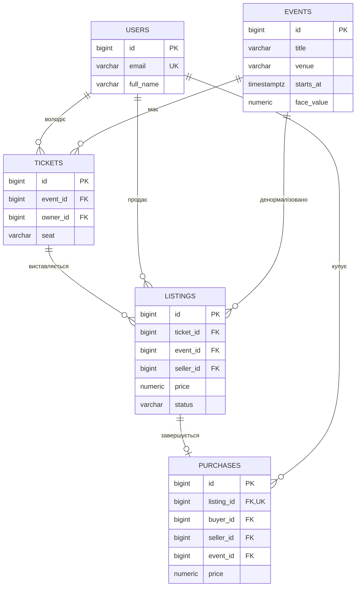
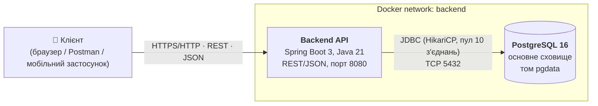
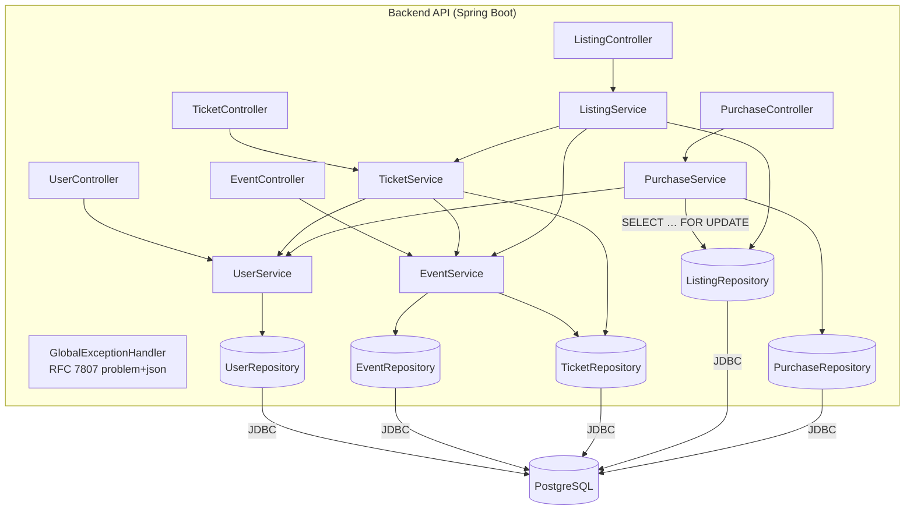
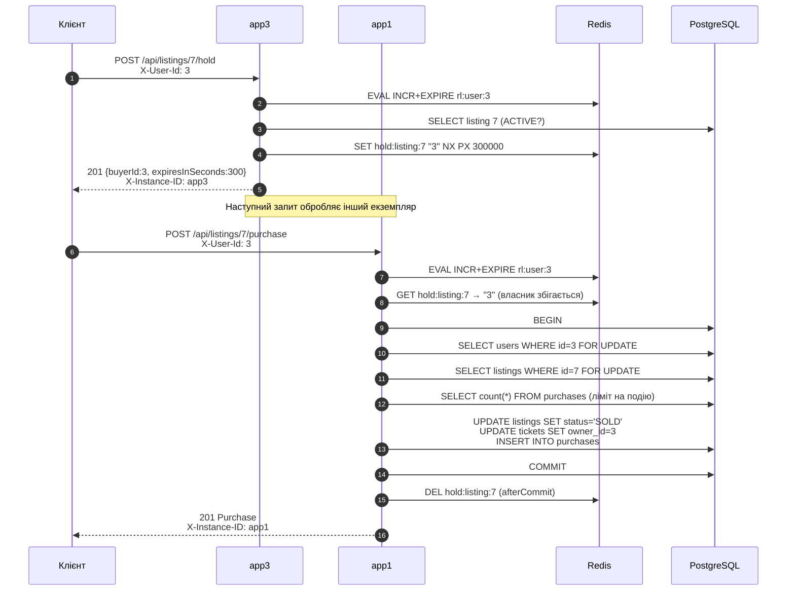
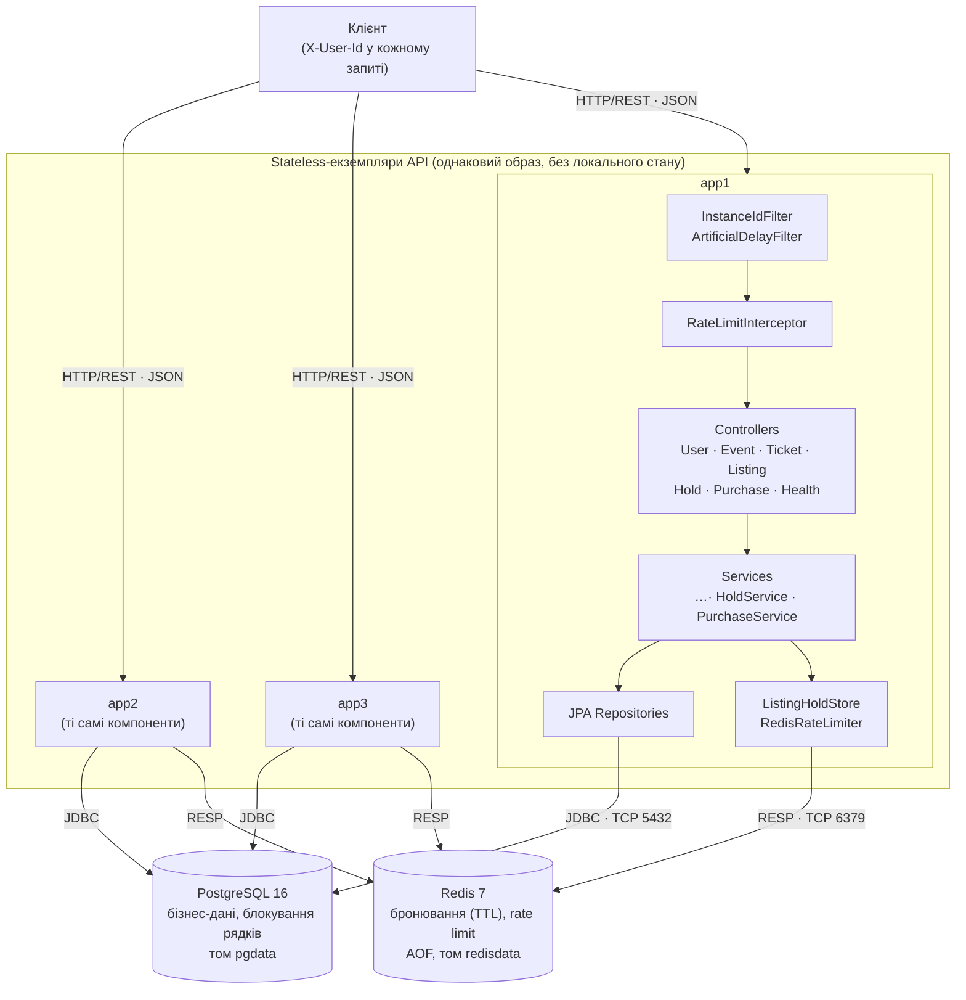
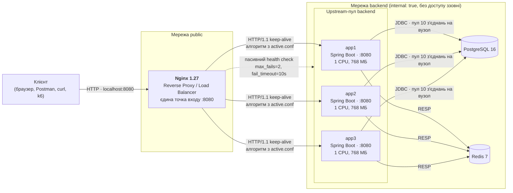

# Ticket Resale — платформа перепродажу квитків

Лабораторні роботи № 1–3: проєктування архітектури та базовий прототип (ЛР1), архітектура без стану (ЛР2), горизонтальне масштабування та балансування навантаження (ЛР3).

Платформа дозволяє власникам квитків виставляти їх на перепродаж, а покупцям — бронювати й купувати квитки на події. Ціна перепродажу обмежена (не більше +20% до номіналу), кількість квитків на одну подію для одного покупця обмежена (4 шт.), частота бронювань і купівель обмежена (20 на хвилину на користувача) — для протидії ботам і масовому скуповуванню.

**Стек:** Java 21, Spring Boot 3.3, Spring Data JPA (Hibernate 6), PostgreSQL 16, Redis 7, Flyway, Nginx 1.27, Docker Compose, k6, springdoc-openapi.

**Зміст**

1. [Запуск](#1-запуск)
2. [Доменна модель](#2-доменна-модель) · 3. [Архітектура](#3-архітектура) · 4. [API](#4-api) · 5. [High-Load Scenario](#5-піковий-сценарій-навантаження-high-load-scenario) · 6. [Bottleneck Analysis](#6-аналіз-потенційних-вузьких-місць-bottleneck-analysis) — ЛР1
7. [ЛР2. Архітектура без стану](#7-лр2-архітектура-без-стану-stateless)
8. [ЛР3. Горизонтальне масштабування та балансування](#8-лр3-горизонтальне-масштабування-та-балансування-навантаження)
9. [Структура репозиторію](#9-структура-репозиторію) · 10. [RACI](#10-розподіл-відповідальності-raci)

---

## 1. Запуск

Потрібно: Docker з плагіном Compose (Docker Desktop або Docker Engine), 4+ ядра CPU і 6+ ГБ RAM для повного стеку з трьома екземплярами. Демонстраційні скрипти — bash (Linux, macOS або Git Bash у Windows).

```bash
git clone https://github.com/<акаунт>/concert-ticket-system.git
cd concert-ticket-system
docker compose up -d --build
```

Команда піднімає PostgreSQL, Redis, три екземпляри API (`app1`, `app2`, `app3`) і балансувальник Nginx. Nginx стартує лише після того, як усі екземпляри пройшли healthcheck (≈ 40–60 с).

| Ресурс | Адреса |
|---|---|
| API (єдина точка входу — Nginx) | http://localhost:8080/api |
| Health check екземпляра | http://localhost:8080/health |
| Swagger UI | http://localhost:8080/swagger-ui.html |
| OpenAPI JSON | http://localhost:8080/v3/api-docs |

Назовні опубліковано лише порт балансувальника. Екземпляри API, PostgreSQL і Redis доступні тільки у внутрішній мережі `backend` (див. [8.2](#82-єдина-точка-входу-та-інкапсуляція-мережі)).

Схема БД і демо-дані створюються автоматично міграціями Flyway (`src/main/resources/db/migration`) під час старту застосунку. При одночасному старті кількох екземплярів міграцію виконує лише один: Flyway бере advisory lock PostgreSQL.

Зупинка: `docker compose down` (дані зберігаються в томах `pgdata` і `redisdata`). Повне очищення разом з даними: `docker compose down -v`.

### Перевірка збереження даних (persistence)

```bash
# 1. Створити користувача
curl -X POST localhost:8080/api/users -H "Content-Type: application/json" \
     -d '{"email":"test@example.com","fullName":"Тестовий Користувач"}'
# 2. Перезапустити контейнер БД
docker compose restart postgres
# 3. Переконатися, що запис на місці (id з кроку 1)
curl localhost:8080/api/users/4
```

Дані зберігаються в іменованому томі `pgdata`, змонтованому в `/var/lib/postgresql/data`.

### Демонстраційні скрипти

| Скрипт | Робота | Що демонструє |
|---|---|---|
| `scripts/lab2-cross-instance.sh` | ЛР2 | Ланцюжок запитів через різні екземпляри без sticky sessions; спільний rate limit |
| `scripts/lab2-instance-loss.sh` | ЛР2 | Аварійна зупинка екземпляра посеред бізнес-сценарію |
| `scripts/lab3-distribution.sh [N]` | ЛР3 | Розподіл N запитів за `X-Instance-ID` для активного алгоритму |
| `scripts/lb-switch.sh <профіль>` | ЛР3 | Live-переключення алгоритму балансування (reload без простою) |
| `scripts/lab3-slow-node.sh [мс]` | ЛР3 | Повільний вузол: Round Robin проти Least Connections |
| `scripts/lab3-failover.sh [stop\|kill]` | ЛР3 | Зупинка вузла під навантаженням, перевірка відсутності 5xx |
| `scripts/lab3-scale.sh` | ЛР3 | Scale-out: пропускна здатність для 1, 2, 3 вузлів |

Скрипти навантаження запускають k6 у контейнері (окремо встановлювати не потрібно); результати зберігаються в каталозі `results/`.

---

## 2. Доменна модель

| Сутність | Призначення |
|---|---|
| **User** | Користувач платформи: і продавець, і покупець |
| **Event** | Подія (концерт, фестиваль) з номінальною ціною квитка `face_value` |
| **Ticket** | Конкретний квиток (місце) на подію, має поточного власника |
| **Listing** | Оголошення про перепродаж квитка: ціна, статус `ACTIVE / SOLD / CANCELLED` |
| **Purchase** | Факт купівлі: фіксує ціну, продавця, покупця й подію на момент угоди |



Обмеження цілісності на рівні БД:

- `UNIQUE (event_id, seat)` у `tickets` — одне місце на подію існує лише раз;
- частковий унікальний індекс `ux_listings_active_ticket ON listings(ticket_id) WHERE status='ACTIVE'` — квиток не може мати двох активних оголошень одночасно;
- `UNIQUE (listing_id)` у `purchases` — одне оголошення продається лише один раз;
- `CHECK` на додатні ціни та допустимі статуси.

---

## 3. Архітектура

Обрано **модульний моноліт** з шаровою архітектурою (Controller → Service → Repository). Код розділено на модулі за бізнес-можливостями (`user`, `event`, `ticket`, `listing`, `purchase`), а не за технічними шарами. Модулі взаємодіють лише через сервіси один одного, тому кожен з них за потреби можна виділити в окремий мікросервіс без переписування бізнес-логіки.

Обґрунтування: для MVP мікросервіси додали б мережеві виклики та розподілені транзакції там, де вони не потрібні. Найкритичніша операція — купівля — має бути атомарною (оголошення → SOLD, квиток → новому власнику, запис покупки), що просто забезпечується однією локальною ACID-транзакцією PostgreSQL.

### Діаграма контейнерів (C4, рівень Container) — базовий прототип ЛР1

Актуальна схема з балансувальником і кількома екземплярами — у [8.1](#81-архітектура-з-балансувальником-c4-рівень-container).



### Діаграма компонентів Backend API (C4, рівень Component)



Зовнішніх інтеграцій і черг повідомлень на етапі ЛР1 немає. Потенційні точки розширення: платіжний шлюз, сповіщення email (через чергу RabbitMQ/Kafka), кеш Redis для каталогу подій. Redis додано в ЛР2 як спільне сховище бронювань і лічильників rate limit (див. [7](#7-лр2-архітектура-без-стану-stateless)).

---

## 4. API

Повна специфікація — у Swagger UI. Поточний користувач передається заголовком `X-User-Id` (заглушка замість автентифікації; у наступних роботах замінюється на JWT).

| Метод | Шлях | Опис | Успіх |
|---|---|---|---|
| POST | `/api/users` | Реєстрація користувача | 201 |
| GET | `/api/users/{id}` | Профіль користувача | 200 |
| POST | `/api/events` | Створення події | 201 |
| GET | `/api/events?page=&size=&sort=` | Майбутні події (пагінація) | 200 |
| GET | `/api/events/{id}` | Подія за id | 200 |
| PUT | `/api/events/{id}` | Оновлення події | 200 |
| DELETE | `/api/events/{id}` | Видалення події (якщо немає квитків) | 204 |
| POST | `/api/tickets` | Первинний випуск квитка власнику | 201 |
| GET | `/api/users/{id}/tickets` | Квитки користувача | 200 |
| POST | `/api/listings` | **Виставити квиток на перепродаж** (`X-User-Id`) | 201 |
| GET | `/api/listings/{id}` | Оголошення за id | 200 |
| GET | `/api/events/{id}/listings?maxPrice=&page=&size=` | **Активні оголошення події**, сортування за ціною | 200 |
| DELETE | `/api/listings/{id}` | Скасувати оголошення (лише продавець, `X-User-Id`) | 204 |
| POST | `/api/listings/{id}/purchase` | **Купити квиток** (`X-User-Id`) | 201 |
| GET | `/api/users/{id}/purchases` | Історія покупок | 200 |
| POST | `/api/listings/{id}/hold` | **Забронювати оголошення** на 5 хв (`X-User-Id`); повторний виклик власником — 200 | 201 |
| GET | `/api/listings/{id}/hold` | Поточне бронювання: покупець і залишок часу | 200 |
| DELETE | `/api/listings/{id}/hold` | Зняти власне бронювання (`X-User-Id`) | 204 |
| GET | `/health` | Готовність екземпляра: БД, Redis, `instance` | 200 / 503 |

### Бізнес-правила та коди помилок

Помилки повертаються у форматі RFC 7807 (`application/problem+json`).

| Ситуація | Код |
|---|---|
| Невалідне тіло запиту (порожні поля, некоректний email, від'ємна ціна, дата в минулому) | 400 |
| Відсутній заголовок `X-User-Id` | 400 |
| Продаж чужого квитка / скасування чужого оголошення | 403 |
| Ресурс не знайдено | 404 |
| Оголошення вже продано або скасовано; оголошення заброньоване іншим покупцем; дублікат email; дублікат місця; вже є активне оголошення | 409 |
| Ціна > номінал × 1.20; купівля або бронювання власного квитка; перевищено ліміт 4 квитки на подію; подія вже почалася | 422 |
| Більше 20 бронювань/купівель на користувача за хвилину (заголовок `Retry-After`) | 429 |
| Недоступна БД або Redis, вичерпано пул з'єднань | 503 |

Параметри правил задаються в `application.yml` (`resale.rules.*`, `resale.hold.ttl`, `resale.rate-limit.requests-per-minute`).

### Приклад демонстраційного сценарію

Демо-дані: користувачі id 1–3, події id 1–2, оголошення id 1 (квиток Олени, 650 грн) та id 2 (квиток Андрія, 700 грн) на подію 1.

```bash
# Активні оголошення події 1, найдешевші першими
curl "localhost:8080/api/events/1/listings"

# Олена (id=1) виставляє другий квиток (id=2) за 700 грн
curl -X POST localhost:8080/api/listings -H "X-User-Id: 1" -H "Content-Type: application/json" \
     -d '{"ticketId":2,"price":700}'

# Спроба виставити за 1000 грн при номіналі 600 → 422
curl -X POST localhost:8080/api/listings -H "X-User-Id: 2" -H "Content-Type: application/json" \
     -d '{"ticketId":3,"price":1000}'

# Ірина (id=3) купує оголошення 1 → 201, квиток переходить до Ірини
curl -X POST localhost:8080/api/listings/1/purchase -H "X-User-Id: 3"

# Повторна купівля того ж оголошення → 409
curl -X POST localhost:8080/api/listings/1/purchase -H "X-User-Id: 2"

# Квитки та покупки Ірини
curl localhost:8080/api/users/3/tickets
curl localhost:8080/api/users/3/purchases
```

---

## 5. Піковий сценарій навантаження (High-Load Scenario)

**Старт перепродажу на популярну подію.** Після оголошення про sold-out на первинному ринку тисячі користувачів одночасно:

1. багаторазово оновлюють `GET /api/events/{id}/listings` (read-heavy, сотні RPS на одну подію);
2. намагаються купити ті самі найдешевші оголошення через `POST /api/listings/{id}/purchase` (write-heavy, висока конкуренція за кілька рядків).

Купівля — найдорожча операція: в одній транзакції виконуються читання користувача, `SELECT … FOR UPDATE` оголошення, `COUNT` покупок, два `UPDATE` (listings, tickets) та `INSERT` (purchases).

---

## 6. Аналіз потенційних вузьких місць (Bottleneck Analysis)

### 6.1. Конкуренція за блокування рядка оголошення

- **Компонент / операція:** `POST /api/listings/{id}/purchase` → `ListingRepository.findByIdForUpdate` (`SELECT … FOR UPDATE`).
- **Причина (Root Cause):** Lock Contention. Усі покупці найдешевшого оголошення стають у чергу на один рядок. Блокування утримується до кінця транзакції; лише перший запит завершується успіхом, решта після очікування отримує 409. Час очікування не обмежено.
- **Симптоматика:** різке зростання p99 latency купівлі (секунди замість мілісекунд), лінійне зростання кількості очікуючих транзакцій у `pg_locks`/`pg_stat_activity` (`wait_event_type = Lock`), падіння корисного throughput при зростанні RPS.
- **Шляхи усунення:** `FOR UPDATE NOWAIT`/`lock_timeout` для швидкої відмови; атомарний умовний `UPDATE listings SET status='SOLD' WHERE id=? AND status='ACTIVE'` без попереднього блокування; черга покупок; тимчасове резервування оголошення (hold на N хвилин). **Резервування реалізовано в ЛР2:** конкуренція покупців вирішується атомарним `SET NX` у Redis, і до блокування рядка доходить лише власник бронювання.

### 6.2. Вичерпання пулу з'єднань до БД

- **Компонент:** HikariCP (`maximum-pool-size: 10`) між Backend API та PostgreSQL.
- **Причина (Root Cause):** Connection Pool Exhaustion. Транзакції купівлі, що чекають на блокування з п. 6.1, тримають з'єднання весь час очікування. 10 «завислих» покупок займають увесь пул, і навіть прості читання (`GET /api/events`) не можуть отримати з'єднання.
- **Симптоматика:** метрика `hikaricp.connections.pending` > 0, `hikaricp.connections.usage` близько 100%, помилки `SQLTransientConnectionException: Connection is not available, request timed out after 5000ms` → HTTP 500; каскадна деградація всіх endpoints, а не лише купівлі; зростання кількості зайнятих потоків Tomcat (до 200).
- **Шляхи усунення:** скорочення часу утримання блокування (п. 6.1), окремі пули для читання й запису, read-репліка PostgreSQL, PgBouncer, rate limiting на купівлю (реалізовано в ЛР2).

### 6.3. Пошук оголошень популярної події: глибока пагінація та COUNT

- **Компонент / запит:** `GET /api/events/{id}/listings?page=N` → `findActiveByEvent` + окремий `countQuery`.
- **Причина (Root Cause):** I/O та CPU БД. Пагінація `LIMIT/OFFSET`: для сторінки N база читає й відкидає N×size рядків. Для кожного запиту `Page` додатково виконується `SELECT COUNT(*)` по всіх активних оголошеннях події. Індекс `(event_id, status, price)` прискорює фільтр і сортування, але не усуває лінійну вартість OFFSET і COUNT. Без цього індексу запит виконував би Seq Scan по всій таблиці `listings`.
- **Симптоматика:** латентність росте пропорційно номеру сторінки та кількості оголошень; зростання `shared_buffers` read/hit і CPU БД при масовому оновленні сторінки; 2 SQL-запити на кожен HTTP-запит.
- **Шляхи усунення:** keyset (cursor) pagination `WHERE price > :lastPrice`, `Slice` замість `Page` (без COUNT), кешування першої сторінки в Redis з коротким TTL.

### 6.4. N+1 при формуванні відповідей з лінивими зв'язками

- **Компонент:** серіалізація сутностей з `FetchType.LAZY` (`Ticket.event`, `Listing.ticket`).
- **Причина (Root Cause):** N+1 problem — за наївної реалізації для кожного з N квитків виконується окремий запит за подією.
- **Симптоматика:** кількість SQL-запитів на один HTTP-запит пропорційна розміру результату; ріст latency і навантаження на пул з'єднань.
- **Реалізовані запобіжники:** `JOIN FETCH` у `TicketRepository.findAllByOwnerWithEvent`, проєкція в DTO одним запитом у `ListingRepository.findActiveByEvent`, `spring.jpa.open-in-view: false` (лінива ініціалізація поза транзакцією неможлива, тож N+1 виявляється ще на етапі розробки).

### 6.5. Єдиний екземпляр PostgreSQL

- **Компонент:** PostgreSQL — єдина точка запису та відмови (SPOF).
- **Причина (Root Cause):** вертикальне масштабування обмежене; WAL-записи та fsync при кожному COMMIT покупки (I/O Wait).
- **Симптоматика:** при недоступності БД — 100% помилок усіх endpoints; при піковому записі — зростання `commit latency` і `iowait` на хості.
- **Шляхи усунення:** реплікація (primary + read-репліки), горизонтальне масштабування API за балансувальником (застосунок stateless), партиціонування `listings`/`purchases` за подіями.

---

## 7. ЛР2. Архітектура без стану (Stateless)

Мета — зробити кожен екземпляр API взаємозамінним (Interchangeable Worker): будь-який екземпляр обробляє будь-який запит, а зупинка екземпляра не призводить до втрати бізнес-стану.

### 7.1. Аудит та класифікація стану (State Audit)

Проаналізовано всі класи шарів Controller / Service / Repository, фільтри, конфігурацію Spring і контейнера.

| Категорія | Елемент стану | Де зберігається | Обґрунтування |
|---|---|---|---|
| **Ephemeral / Local Safe** | Локальні змінні, DTO, контекст персистентності Hibernate | Стек потоку / пам'ять JVM у межах одного запиту | Живе лише до кінця транзакції (`open-in-view: false`) і не переходить між запитами |
| | Пул з'єднань HikariCP, пул потоків Tomcat | Пам'ять JVM | Інфраструктурні ресурси процесу, не бізнес-стан; відновлюються при старті |
| | Логи, метрики Actuator / Micrometer | stdout контейнера, пам'ять JVM | Діагностичні дані конкретного вузла; втрата при перезапуску допустима |
| | Конфігурація: `ResaleRules`, `HoldProperties`, `RateLimitProperties`, `InstanceProperties` | Пам'ять JVM (незмінні `record`) | Читаються зі змінних оточення при старті, однакові для всіх вузлів (крім `INSTANCE_ID`), не змінюються під час роботи |
| **Shared / Externalized** | Бізнес-дані: користувачі, події, квитки, оголошення, покупки | PostgreSQL | Основне сховище, ACID-транзакції |
| | Бронювання оголошень (hold) | Redis, ключ `hold:listing:{id}`, TTL 5 хв | Тимчасовий бізнес-стан; термін дії відраховує Redis |
| | Лічильники rate limit | Redis, ключ `rl:user:{id}`, TTL 60 с | Ліміт має бути спільним для всіх вузлів |
| | Ідентичність користувача | Заголовок `X-User-Id` у кожному запиті | Контекст передається клієнтом; серверних сесій немає (у подальшому — JWT) |
| | Блокування під час купівлі | PostgreSQL, `SELECT … FOR UPDATE` | Діють для всіх екземплярів одночасно |
| | Стан міграцій схеми | PostgreSQL, `flyway_schema_history` + advisory lock | Паралельний старт кількох вузлів безпечний |
| **Critical Stateful Dependencies** | `HttpSession`, cookie `JSESSIONID` | — | Не використовуються: жодного звернення до сесії в коді, Spring Security відсутній |
| | Мутабельні `static`-поля | — | Відсутні: лише `static final` константи й логери |
| | In-memory колекції в singleton-біни (кеші, мапи) | — | Відсутні: усі сервіси мають лише `final`-поля з залежностями |
| | Локальні кеші (`@Cacheable` з `ConcurrentMapCacheManager`, Caffeine) | — | Не використовуються |
| | Application-level locks (`synchronized`, `ReentrantLock`) | — | Не використовуються; координація паралельних операцій — у PostgreSQL |
| | Локальні лічильники, таймери (`@Scheduled`), файлові сесії | — | Не використовуються |
| | Годинник JVM (`Instant.now()` у `Event.hasStarted()`) | Годинник хоста | Залишковий ризик розбіжності часу між вузлами; контейнери на одному хості мають спільний годинник, у кластері — синхронізація NTP. Строки бронювань і вікна rate limit відраховує Redis |

### 7.2. Усунені та не допущені stateful-залежності

Базовий прототип ЛР1 від початку проєктувався без серверного стану, тому прихованого стану в пам'яті процесу аудит не виявив. У межах ЛР2 зроблено таке:

1. **Усунено гонку при перевірці ліміту квитків на подію.** У ЛР1 перевірка «≤ 4 квитки на подію» виконувалась як `COUNT`, а потім `INSERT` без координації. Два паралельні запити одного покупця на різні оголошення могли обидва пройти перевірку. Виправлення в межах одного процесу через `synchronized` не діяло б між екземплярами. Додано блокування рядка покупця в PostgreSQL (`UserRepository.findByIdForUpdate`), спільне для всіх вузлів.
2. **Нові функції, які зазвичай реалізують зі станом у пам'яті, реалізовано через зовнішнє сховище:**

| Функція | Типова stateful-реалізація (не допущена) | Реалізація в проєкті |
|---|---|---|
| Бронювання оголошення на 5 хв | `ConcurrentHashMap<listingId, Hold>` + `@Scheduled` для очищення | Redis `SET key buyer NX PX ttl`; зняття — Lua compare-and-delete (`ListingHoldStore`) |
| Rate limit на користувача | `ConcurrentHashMap<userId, AtomicInteger>`; при N вузлах ліміт фактично N × 20 | Redis `INCR` + `EXPIRE` атомарним Lua-скриптом (`RedisRateLimiter`) |
| Ідентифікація вузла | — | Незмінний `INSTANCE_ID` зі змінної оточення, заголовок `X-Instance-ID` (`InstanceIdFilter`) |

### 7.3. Stateless Request Flow: купівля заброньованого квитка

Сценарій «бронювання на одному вузлі → купівля на іншому» — `POST /api/listings/{id}/purchase`.

- **Вхідні параметри:** `listingId` (шлях), `X-User-Id` (контекст користувача). Cookie та серверні сесії не використовуються.
- **Читання контексту зі shared storage:** лічильник rate limit і власник бронювання — з Redis; покупець, оголошення, подія, кількість покупок — з PostgreSQL.
- **Атомарні зміни стану:** інкремент лічильника — Lua-скрипт Redis; зміни в PostgreSQL — одна транзакція (оголошення → `SOLD`, квиток → новому власнику, запис покупки); зняття бронювання — після `COMMIT`.
- **Залишкові мутації в пам'яті JVM:** відсутні. Контекст персистентності закривається разом з транзакцією, поля singleton-бінів не змінюються.



### 7.4. Мульти-екземплярне розгортання та ідентифікація вузлів

У `docker-compose.yml` описано три екземпляри (`app1`, `app2`, `app3`) з одного образу `ticket-resale-app`. Вони відрізняються лише змінною `INSTANCE_ID`. `InstanceIdFilter` додає заголовок `X-Instance-ID` до кожної відповіді, зокрема до відповідей з помилками. Те саме значення повертає `GET /health`.

```bash
curl -si localhost:8080/api/events | grep -i x-instance-id
# X-Instance-ID: app2
```

Екземпляри не мають опублікованих портів. Тому запити до конкретного вузла в обхід балансувальника скрипти ЛР2 виконують через `curl` усередині контейнера цього вузла (`docker compose exec app1 curl http://localhost:8080/...`).

### 7.5. Моделювання збоїв та тестування консистентності

**Cross-Instance Consistency** — `scripts/lab2-cross-instance.sh`:

| Крок | Вузол | Запит | Очікування |
|---|---|---|---|
| 1 | app1 | `POST /api/events` | 201, створено подію |
| 2 | app2 | `GET /api/events/{id}` | 200, дані з кроку 1 |
| 3 | app2 | `PUT /api/events/{id}` | 200, назву змінено |
| 4 | app1 | `GET /api/events/{id}` | 200, нова назва з кроку 3 |
| 5 | app2 | `POST /api/listings` | 201, оголошення |
| 6 | app3 | `POST /api/listings/{id}/hold` (покупець 3) | 201, бронювання в Redis |
| 7 | app1 | `GET /api/listings/{id}/hold` | 200, власник — покупець 3 |
| 8 | app2 | `POST …/purchase` (покупець 2) | 409, оголошення заброньоване іншим |
| 9 | app1 | `POST …/purchase` (покупець 3) | 201, купівля успішна |
| 10 | app3, app2 | `GET /api/listings/{id}`, `GET /api/users/3/tickets` | `SOLD`, квиток у покупця 3 |
| 11 | app1→app2→app3… | 25 × `POST …/hold` новим користувачем | 429 після 20-го запиту — лічильник спільний |

**Restart / Instance Loss** — `scripts/lab2-instance-loss.sh`:

1. На app1 створюється оголошення і бронювання для покупця 3.
2. `docker compose kill app1` — аварійна зупинка (SIGKILL, без graceful shutdown).
3. app2 повертає те саме бронювання та успішно завершує купівлю; app3 бачить покупку в історії.
4. Повторна купівля того ж оголошення іншим покупцем → 409.
5. app1 перезапускається і повертає актуальний стан: оголошення `SOLD`, бронювання знято.

Кожен крок скрипта перевіряє статус і вміст відповіді; при розбіжності скрипт завершується з помилкою. Для звіту вивід зберігається командою:

```bash
scripts/lab2-cross-instance.sh | tee results/lab2-cross-instance.txt
scripts/lab2-instance-loss.sh  | tee results/lab2-instance-loss.txt
```

### 7.6. Архітектурна схема після ЛР2 (C4, рівень Component)



### 7.7. Stateless ≠ відсутність даних; ризики прихованої affinity

Stateless-архітектура не означає, що система не має стану. Стан існує, але зберігається поза процесом застосунку, у спільних сховищах (PostgreSQL, Redis), а кожен запит несе власний контекст (`X-User-Id`). Тому стійкість до відмов переходить на рівень сховищ: Redis і PostgreSQL стають критичними залежностями (див. [8.6](#86-scale-out-експеримент-та-вузькі-місця-після-масштабування)).

Ризики прихованої affinity (прив'язки клієнта до вузла):

- **IP Hash / sticky sessions на балансувальнику** приховують stateful-помилки: тести проходять, доки клієнт потрапляє на «свій» вузол. Тому перевірки ЛР2 виконуються прямими запитами до різних вузлів, а основний алгоритм ЛР3 — Round Robin.
- **Локальний кеш** без інвалідації між вузлами повертає застарілі дані після зміни на іншому вузлі (крок 4 сценарію cross-instance це перевіряє).
- **Keep-alive з'єднання** клієнта до балансувальника не створюють affinity до вузла: Nginx обирає вузол для кожного запиту окремо.
- **Відкладені задачі в пам'яті** (таймери, `@Async` без черги) втрачаються разом з вузлом; строки бронювань тому відраховує Redis TTL.

---

## 8. ЛР3. Горизонтальне масштабування та балансування навантаження

### 8.1. Архітектура з балансувальником (C4, рівень Container)



### 8.2. Єдина точка входу та інкапсуляція мережі

| Компонент | Мережі | Опублікований порт | Доступний клієнту |
|---|---|---|---|
| `nginx` | `public`, `backend` | `8080 → 80` | Так — єдина адреса |
| `app1`, `app2`, `app3` | `backend` | — | Ні |
| `postgres`, `redis` | `backend` | — | Ні |
| `k6` (генератор навантаження) | `public` | — | Звертається лише до `nginx` |

Мережа `backend` оголошена як `internal: true`, тобто не має виходу за межі Docker. Порти вузлів, БД і Redis не опубліковані, тому клієнт бачить лише `localhost:8080` — Nginx. Перевірка: у виводі `docker compose ps` опублікований порт має тільки `resale-lb`.

Конфігурація: `nginx/nginx.conf` (проксіювання, таймаути, повтори) + `nginx/upstreams/active.conf` (пул і алгоритм).

### 8.3. Алгоритми балансування: дослідження та порівняння

Профілі пулу зберігаються в `nginx/upstreams/`. Перемикання виконується без простою: `scripts/lb-switch.sh <профіль>` копіює профіль в `active.conf`, перевіряє конфігурацію (`nginx -t`) і робить `nginx -s reload`. Нові worker-процеси отримують новий алгоритм, старі завершують поточні запити.

| Профіль | Директива Nginx | Призначення |
|---|---|---|
| `round-robin` | (за замовчуванням) | Рівномірний розподіл по черзі; базовий алгоритм |
| `least-conn` | `least_conn;` | Запит отримує вузол з найменшою кількістю активних з'єднань; для запитів різної тривалості |
| `weighted` | `weight=3 / 1 / 1` | Імітація гетерогенної інфраструктури: app1 «утричі потужніший» |
| `ip-hash` | `ip_hash;` | Прив'язка клієнта до вузла за IP — sticky session на мережевому рівні |
| `scale-1`, `scale-2` | 1 або 2 сервери в пулі | Для scale-out експерименту |

#### Розподіл послідовних запитів (`scripts/lab3-distribution.sh 30`)

| Профіль | app1 | app2 | app3 | Очікування |
|---|---|---|---|---|
| round-robin | | | | По 10 (33 %), послідовність app1 → app2 → app3 → … |
| weighted | | | | ≈ 18 / 6 / 6 (60 / 20 / 20 %) — пропорційно вагам 3:1:1 |
| ip-hash | | | | 30 / 0 / 0 — усі запити з однієї IP на один вузол |
| least-conn | | | | Близько до рівномірного: при послідовних запитах активних з'єднань немає, вибір між рівними вузлами відбувається по черзі |

_Стовпці app1–app3 заповнюються за виводом скрипта._

Висновок щодо IP Hash: у Docker усі запити з хоста надходять з однієї адреси шлюзу мережі, тому IP Hash спрямовує весь трафік на один вузол. Крім того, Nginx `ip_hash` хешує лише перші три октети IPv4, тому всі клієнти з однієї підмережі /24 потрапляють на один вузол. Це ілюструє ризик прихованої affinity (див. [7.7](#77-stateless--відсутність-даних-ризики-прихованої-affinity)): за NAT або корпоративним проксі тисячі клієнтів мають одну IP-адресу, і навантаження розподіляється нерівномірно. Оскільки застосунок stateless, сесійна прив'язка йому не потрібна, тому IP Hash для цієї системи не обрано.

#### Експеримент з асиметричним навантаженням (`scripts/lab3-slow-node.sh 300`)

На `app2` вмикається синтетична затримка 300 мс на кожен запит (`ARTIFICIAL_DELAY_MS`, `ArtificialDelayFilter`; `/health` не сповільнюється). Під однаковим навантаженням (30 паралельних клієнтів, 30 с, `GET /api/events/1/listings`) порівнюються два алгоритми.

| Метрика | Round Robin | Least Connections |
|---|---|---|
| Пропускна здатність, RPS | | |
| Latency p95, мс | | |
| Latency p99, мс | | |
| Частка запитів на app2 (повільний), % | | |
| Помилки, % | | |

_Значення — з `results/slow-node-round-robin.txt` і `results/slow-node-least-conn.txt`._

Теоретичне обґрунтування очікуваних результатів:

- **Round Robin** не враховує стан вузла: app2 отримує ⅓ запитів незалежно від того, що кожен з них триває ≥ 300 мс. Принаймні третина відповідей повільна, тож p95 і p99 ≥ 300 мс. У закритій моделі навантаження (фіксована кількість клієнтів) клієнти «застрягають» на повільному вузлі, і загальна пропускна здатність падає, хоча app1 і app3 простоюють.
- **Least Connections** враховує кількість активних з'єднань. На app2 запити утримують з'єднання довше, тож у нього постійно більше активних з'єднань і він отримує значно менше нових запитів. Частка app2 падає нижче 33 %, RPS зростає, p95 знижується. p99 може лишатися ≥ 300 мс, доки app2 отримує хоча б 1 % запитів.
- **Висновок:** для запитів зі змінною тривалістю (купівля з блокуваннями, глибока пагінація) і для неоднорідних вузлів доцільно використовувати Least Connections. Round Robin підходить лише для однорідних вузлів і коротких запитів однакової вартості.

### 8.4. Health Check та Fault Tolerance

**Endpoint `GET /health`** (`HealthController`):

| Стан | HTTP | Умова |
|---|---|---|
| `UP` | 200 | PostgreSQL і Redis відповідають |
| `DEGRADED` | 200 | PostgreSQL доступний, Redis — ні: каталог працює, бронювання повертають 503 |
| `DOWN` | 503 | PostgreSQL недоступний — вузол не може обробити жодного бізнес-запиту |

```json
{"status":"UP","instance":"app1","checks":{"database":"UP","redis":"UP"}}
```

Недоступність Redis не виводить вузол з пулу: Redis спільний для всіх вузлів, тому виключення одного вузла нічого не змінить, а виключення всіх зупинило б і ті функції, що від Redis не залежать.

**Механізми виявлення відмов:**

| Рівень | Механізм | Параметри |
|---|---|---|
| Nginx — пасивний | Збої реальних запитів (`error`, `timeout`, `502/503/504`) рахуються для вузла; після `max_fails` збоїв вузол виключається з пулу на `fail_timeout`, потім отримує пробний запит | `max_fails=2 fail_timeout=10s`, `proxy_connect_timeout 1s` |
| Nginx — повтор запиту | Запит, що не вдався на одному вузлі, повторюється на наступному; клієнт отримує успішну відповідь | `proxy_next_upstream error timeout http_502 http_503 http_504`, до 3 спроб |
| Docker — активний | Docker кожні 5 с викликає `GET /health` усередині контейнера; стан `unhealthy` видно в `docker compose ps`, Nginx стартує лише після `healthy` усіх вузлів | `interval 5s, timeout 3s, retries 3` |
| Spring — graceful shutdown | При `docker stop` вузол перестає приймати нові з'єднання й завершує поточні запити | `server.shutdown: graceful`, до 20 с |

Активні HTTP-перевірки на рівні балансувальника (`health_check`) є лише в комерційній версії Nginx Plus. Аналог у відкритому ПЗ — HAProxy (`option httpchk GET /health`) або Traefik. Для цього стенду поєднання пасивних перевірок Nginx з повтором запитів дає ту саму гарантію для клієнта: жоден запит не повертається з помилкою через недоступний вузол.

Безпечність повторів: неідемпотентні запити (POST купівлі) Nginx повторює лише тоді, коли запит ще не був надісланий вузлу, наприклад коли з'єднання відхилено. Якщо вузол упав після отримання POST, повтору немає. Подвійна купівля в такому випадку неможлива ще й тому, що повторна купівля оголошення повертає 409 (рядкове блокування та статус `SOLD` у PostgreSQL).

#### Експеримент: зупинка вузла під навантаженням (`scripts/lab3-failover.sh stop` і `kill`)

k6 протягом 60 с надсилає запити через Nginx (20 клієнтів). На 15-й секунді `app2` зупиняється, на 30-й — запускається знову.

| Режим | Запитів усього | Помилки, % | p99, мс | Частка app2, % | Повторів на інший вузол |
|---|---|---|---|---|---|
| `stop` (SIGTERM, graceful) | | | | | |
| `kill` (SIGKILL, аварія) | | | | | |

_Значення — з `results/failover-stop.txt`, `results/failover-kill.txt` і виводу скрипта._

Очікувана поведінка: 0 % помилок в обох режимах, бо `GET` ідемпотентний і повторюється на іншому вузлі. Запити, що потрапили на зупинений вузол, отримують додаткову затримку до `proxy_connect_timeout` (1 с), що видно як сплеск p99. Після двох збоїв вузол виключається з пулу на 10 с, і затримка зникає. Після повернення `app2` знову отримує трафік (поверненням керує `scripts/lab3-failover.sh` через `nginx -s reload`, бо при перезапуску контейнера може змінитися його IP).

### 8.5. Балансувальник як Single Point of Failure

Після масштабування API єдиною точкою відмови на вході стає сам Nginx: його зупинка робить систему недоступною, хоча всі три вузли працюють. Шляхи усунення:

- **Keepalived / VRRP** — два екземпляри балансувальника (active + standby) з одною віртуальною IP-адресою. Standby надсилає VRRP-оголошення й перехоплює VIP за 1–3 с після відмови active. Стан балансувальника для переключення не потрібен, бо Nginx не зберігає сесій.
- **DNS Round Robin** — кілька A-записів для домену, кожен вказує на окремий балансувальник. Простий спосіб, але переключення залежить від TTL і кешування DNS у клієнтів, і DNS не перевіряє доступність адрес (потрібен DNS з health checks, наприклад Route 53).
- **Хмарний керований балансувальник** (AWS ALB, GCP Load Balancer) — відмовостійкість на рівні провайдера.
- **Kubernetes** — Service / Ingress Controller з кількома репліками та `externalTrafficPolicy`.

### 8.6. Scale-out експеримент та вузькі місця після масштабування

`scripts/lab3-scale.sh` подає однакове навантаження (60 клієнтів, 30 с, `GET /api/events/1/listings`) на пул з 1, 2 і 3 вузлів. Кожен вузол обмежено 1 CPU (`cpus: "1.0"`), щоб збільшення кількості вузлів відповідало збільшенню обчислювальних ресурсів. Перед вимірюваннями виконується прогрів JVM.

| Вузлів у пулі | RPS | Приріст відносно 1 вузла | p95, мс | p99, мс | Помилки, % |
|---|---|---|---|---|---|
| 1 | | 1,0× | | | |
| 2 | | | | | |
| 3 | | | | | |

_Значення — зі зведеної таблиці, яку друкує скрипт (`results/scale-*.txt`)._

Для коректного висновку зафіксовано умови: усі контейнери (3 вузли, PostgreSQL, Redis, Nginx, k6) працюють на одному хості й конкурують за його ядра.

**Аналіз повносистемних bottlenecks після масштабування compute-шару:**

1. **PostgreSQL: CPU і кількість запитів.** Кожен HTTP-запит до списку оголошень виконує 2 SQL-запити (сторінка + `COUNT`). Масштабування API множить кількість паралельних запитів до однієї СУБД. Коли API вже не є обмеженням, приріст RPS стає сублінійним, а час виконання SQL зростає: у `pg_stat_activity` збільшується кількість активних сесій, у `docker stats` CPU контейнера `resale-postgres` наближається до межі. **Це очікуване наступне вузьке місце.** Шляхи: кешування першої сторінки оголошень у Redis з коротким TTL, `Slice` без `COUNT`, read-репліки PostgreSQL.
2. **Сумарна кількість з'єднань до БД (Database connection pool).** Кожен вузол має пул HikariCP на 10 з'єднань: 3 вузли = 30, 10 вузлів = 100, що дорівнює `max_connections` PostgreSQL за замовчуванням. Подальше масштабування без PgBouncer призводить до відмов `too many connections`, а кожне з'єднання PostgreSQL — це окремий процес із власною пам'яттю.
3. **Shared Storage Locks.** Конкуренція за найдешевше оголошення (`SELECT … FOR UPDATE`) не зменшується від додавання вузлів API: усі вузли стають у ту саму чергу на рядок у PostgreSQL. Бронювання в Redis (ЛР2) зменшує кількість покупців, що доходять до блокування, але операція на один рядок принципово не масштабується горизонтально.
4. **Redis — єдиний екземпляр.** Операції O(1) і не обмежують пропускну здатність на цьому навантаженні, але Redis є SPOF для бронювань (rate limiter у разі відмови пропускає запити). Шлях — Redis Sentinel або Redis Cluster.
5. **CPU балансувальника та Network I/O.** Nginx проксіює невеликі JSON-відповіді з keep-alive до вузлів; його CPU-навантаження на кілька порядків менше за вузли API, тому на цьому масштабі він не є обмеженням. Обмеженням стає мережевий стек одного хоста та те, що генератор навантаження k6 працює на тому самому хості.

**Висновок:** після горизонтального масштабування stateless-шару API обмеження переходить на спільні stateful-компоненти, насамперед на PostgreSQL (CPU, з'єднання, блокування рядків). Наступний крок масштабування — кешування гарячих читань у Redis, пул з'єднань PgBouncer і реплікація БД для читання.

---

## 9. Структура репозиторію

```
concert-ticket-system/
├── docker-compose.yml          # nginx + app1..app3 + postgres + redis (+ k6 у профілі loadtest)
├── Dockerfile                  # multi-stage: Maven build → JRE runtime (+ curl для healthcheck)
├── pom.xml
├── nginx/
│   ├── nginx.conf              # reverse proxy, таймаути, повтори, формат журналу
│   └── upstreams/              # профілі пулу: round-robin, least-conn, weighted, ip-hash, scale-1/2
│       └── active.conf         # активний профіль (змінюється scripts/lb-switch.sh)
├── loadtest/load.js            # сценарій k6
├── scripts/                    # демонстраційні скрипти ЛР2 і ЛР3
├── results/                    # результати прогонів (створюється скриптами)
└── src/main/
    ├── java/com/ticketresale/
    │   ├── common/             # бізнес-правила, винятки, глобальний обробник помилок
    │   ├── infra/              # X-Instance-ID, /health, синтетична затримка (ЛР2–3)
    │   ├── user/               # користувачі
    │   ├── event/              # події
    │   ├── ticket/             # квитки (первинний випуск, власність)
    │   ├── listing/            # оголошення перепродажу
    │   ├── hold/               # бронювання оголошень у Redis (ЛР2)
    │   ├── ratelimit/          # розподілений rate limit у Redis (ЛР2)
    │   └── purchase/           # купівля (піковий сценарій)
    └── resources/
        ├── application.yml
        └── db/migration/       # V1__init_schema.sql, V2__seed_data.sql
```

---

## 10. Розподіл відповідальності (RACI)

R — виконує, A — відповідає за результат, C — консультує, I — інформується.

| Модуль / задача | Христина | Люда | Саша |
|---|---|---|---|
| **ЛР1** | | | |
| Доменний аналіз, ER-модель | A/R | C | C |
| Схема БД, міграції Flyway (`db/migration`) | A/R | C | I |
| Модулі `user`, `event` | A/R | I | I |
| Модуль `ticket` | C | A/R | I |
| Модуль `listing` (правила ціни, пошук оголошень) | I | A/R | C |
| Модуль `purchase` (транзакція купівлі, блокування) | I | C | A/R |
| Обробка помилок, валідація (`common`) | C | A/R | C |
| Dockerfile, docker-compose, мережі, томи | I | C | A/R |
| Архітектурні діаграми (C4) | A/R | C | C |
| Bottleneck Analysis | C | C | A/R |
| **ЛР2** | | | |
| Аудит стану, таблиця класифікації | A/R | C | C |
| Модуль `hold` (бронювання в Redis, Lua compare-and-delete) | C | A/R | I |
| Модуль `ratelimit` (розподілений лічильник) | I | A/R | C |
| Блокування покупця в `purchase`, Stateless Request Flow | C | I | A/R |
| `infra`: X-Instance-ID | I | C | A/R |
| `infra`: `/health` | I | A/R | C |
| Скрипти cross-instance та instance loss | A/R | C | C |
| **ЛР3** | | | |
| Конфігурація Nginx, upstream-профілі, інкапсуляція мереж | I | C | A/R |
| Health check, повтори, graceful shutdown | C | A/R | C |
| Сценарій k6, скрипти експериментів | A/R | C | I |
| Порівняльний аналіз алгоритмів, експеримент з повільним вузлом | C | A/R | C |
| Scale-out експеримент, аналіз bottlenecks після масштабування | A/R | C | C |
| README, специфікація API | A/R | C | C |
