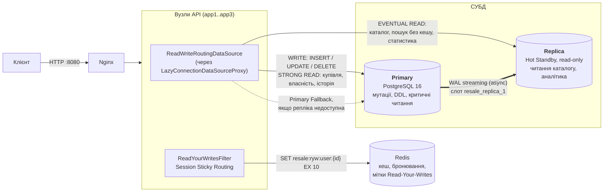

# 11. ЛР6. Реплікація бази даних та розділення читання і запису (Read/Write Separation)

Звіт проєкту Ticket Resale (платформа перепродажу квитків). Опис системи, ЛР1–ЛР5, запуск і розподіл відповідальності — у [README](../README.md).

Мета — винести читання, що допускають узгодженість у кінцевому підсумку, на репліку PostgreSQL, не порушивши гарантій для критичних сценаріїв (купівля, власність квитків), і забезпечити контрольовану поведінку системи при відмові будь-якого вузла СУБД.

Усі демонстрації та вимірювання ЛР6 (≈ 12–15 хв):

```bash
bash scripts/lab6-run-all.sh
```

### 11.1. Топологія реплікації Primary / Replica

| Вузол | Контейнер | Роль | Конфігурація |
|---|---|---|---|
| **Primary** | `resale-postgres` | Приймає всі мутації (INSERT, UPDATE, DELETE, DDL-міграції Flyway) і передає журнал WAL | `wal_level=replica`, `max_wal_senders=10`, `max_replication_slots=10`, `wal_keep_size=256MB`, 1 CPU |
| **Replica** | `resale-postgres-replica` | Hot Standby: безперервно відтворює WAL, відкрита лише для читання | `hot_standby=on`, `hot_standby_feedback=on`, `recovery_min_apply_delay=${REPLICA_APPLY_DELAY:-0}`, 1 CPU |

Тип реплікації — **асинхронна потокова (streaming) фізична реплікація** PostgreSQL: primary фіксує транзакцію локально і не чекає підтвердження від репліки.

Ініціалізація репліки (`db/replication/replica-entrypoint.sh`) при першому запуску з порожнім томом:
1. На primary створюється роль `replicator` з правом `REPLICATION` і фізичний слот реплікації `resale_replica_1`. Обидві операції ідемпотентні.
2. `pg_basebackup -X stream -S resale_replica_1 -R` робить повну копію даних primary. Прапорець `-R` створює `standby.signal` і записує `primary_conninfo`.
3. PostgreSQL стартує в режимі standby і підключається до primary як WAL receiver.

Слот реплікації гарантує, що primary не видалить сегменти WAL, які репліка ще не отримала. Зворотний бік: під час тривалої відмови репліки слот утримує WAL на диску primary.

Доступ для реплікації обмежено в `db/replication/pg_hba.conf`: з'єднання типу `replication` дозволені лише ролі `replicator` з паролем (`scram-sha-256`). Файл підключається до обох вузлів параметром `hba_file`, тому діє і для вже наявного тому даних.

**Демонстрація** — `scripts/lab6-replication-demo.sh`:
1. `pg_stat_replication` на primary показує клієнта `resale-replica` у стані `streaming`; `pg_is_in_recovery()` на репліці повертає `t`.
2. Подія, створена через API (`X-DB-Route: primary`), зчитується SQL-запитом напряму в контейнері репліки.
3. `INSERT` напряму в репліку відхиляється: `cannot execute INSERT in a read-only transaction`.
4. `GET /api/admin/replication` повертає позицію WAL на primary (`pg_current_wal_lsn`), позиції отримання й відтворення на репліці та `replay_lag`.

_Вивід демонстрації — `results/lab6-replication-demo.txt`._

### 11.2. Архітектура з потоками читання і запису (C4, рівень Container)



### 11.3. Read/Write Separation на рівні Data Access Layer

Маршрутизація реалізована програмно в пакеті `db` (Dynamic DataSource Routing):

| Компонент | Призначення |
|---|---|
| `DataSourceConfig` | Два пули HikariCP: `primaryDataSource` (`spring.datasource.*`, також джерело для Flyway) і `replicaDataSource` (`resale.db.replica.*`, `readOnly`, тайм-аут 2 с) |
| `ReadWriteRoutingDataSource` | Обирає вузол для кожного фізичного з'єднання |
| `LazyConnectionDataSourceProxy` | Відкладає отримання з'єднання до першого SQL-запиту, коли вже відомо, чи транзакція `readOnly` |
| `DbRouting` | Явне читання з primary для поточного потоку |
| `ReadYourWritesFilter` | Session Sticky Routing (11.6) |
| `DbNodeStates` | Стан вузлів (circuit breaker): після помилки з'єднання вузол оминається 10 с (`resale.db.retry-after`) без очікування тайм-ауту пулу |

Правила маршрутизації:

| Умова | Вузол | `X-DB-Route` |
|---|---|---|
| Транзакція на запис або запит поза транзакцією | primary | `primary` |
| `@Transactional(readOnly = true)` | replica | `replica` |
| Критичне читання (`DbRouting.strict`) | primary | `primary-strict` |
| Автор нещодавнього запису (мітка в Redis) | primary | `primary-sticky` |
| Наповнення кешу Redis | primary | `primary-cache-fill` |
| Репліка недоступна | primary | `primary-fallback` |
| `READ_REPLICA_ENABLED=false` (Single Primary) | primary | `primary-only` |

Сервісний код не знає про топологію: маршрут визначається атрибутом транзакції, який уже був у коді з ЛР1. Заголовок `X-DB-Route` повертає фактичний вузол для демонстрації та діагностики. Без `LazyConnectionDataSourceProxy` з'єднання бралося б на початку транзакції, ще до встановлення ознаки `readOnly`, і всі читання йшли б на primary.

### 11.4. Класифікація читань за вимогами до консистентності

| Операція | Endpoint | Узгодженість | Вузол | Обґрунтування |
|---|---|---|---|---|
| Каталог подій | `GET /api/events` | Eventual | replica | Публічний список: затримка в частки секунди непомітна |
| Картка події | `GET /api/events/{id}` | Eventual | replica | Публічні дані; автор змін бачить їх завдяки Sticky Routing |
| Пошук оголошень (кеш вимкнено або Redis недоступний) | `GET /api/events/{id}/listings` | Eventual | replica | Перегляд; продаж гарантує перевірка під блокуванням у primary |
| Статистика події (ЛР8) | `GET /api/events/{id}/stats` | Eventual | replica | Аналітичний звіт |
| Наповнення кешу оголошень | MISS у `ListingCache` | Strong | primary | Застарілий рядок з репліки закріпився б у Redis на весь TTL (до 36 с) |
| Статус оголошення | `GET /api/listings/{id}` | Strong | primary | Підтвердження купівлі: покупець перевіряє `SOLD` одразу після оплати |
| Історія покупок | `GET /api/users/{id}/purchases` | Strong | primary | Підтвердження транзакцій |
| Квитки користувача | `GET /api/users/{id}/tickets` | Strong | primary | Власність квитків — аналог стану балансу |
| Профіль користувача | `GET /api/users/{id}` | Strong | primary | Дані автентифікації: новий користувач має одразу проходити перевірки |
| Перевірки бронювання | `POST /api/listings/{id}/hold` | Strong | primary | Щойно створене оголошення могло б ще не дійти до репліки (404) |
| Усі мутації | `POST`, `PUT`, `DELETE` | — | primary | Репліка доступна лише для читання |

### 11.5. Replication Lag і Stale Read

На одному хості затримка асинхронної реплікації становить одиниці мілісекунд, і застаріле читання практично не відтворюється. Тому затримку збільшено синтетично параметром репліки `recovery_min_apply_delay`: репліка отримує WAL одразу, але застосовує коміти із заданою затримкою. Параметр задається змінною `REPLICA_APPLY_DELAY` без зміни коду (`replica_with_delay 5s` у `scripts/lib.sh`).

**Демонстрація** — `scripts/lab6-stale-read.sh 5s`:

| Крок | Запит | Очікуваний `X-DB-Route` | Результат |
|---|---|---|---|
| 1 | `PUT /api/events/{id}`, `X-User-Id: 1` — нова назва | `primary` | 200 |
| 2 | `GET /api/events/{id}`, `X-User-Id: 2` — інший користувач | `replica` | **стара назва — Stale Read** |
| 3 | `GET /api/events/{id}`, `X-User-Id: 1` — автор зміни | `primary-sticky` | нова назва |
| 4 | `GET /api/admin/replication` | — | `replay_lag` ≈ 5 с, LSN репліки відстає від primary |
| 5 | `GET /api/listings/1`, `GET /api/users/3/purchases` | `primary-strict` | критичні дані завжди з primary |
| 6 | Через 5 с: `GET /api/events/{id}`, `X-User-Id: 2` | `replica` | нова назва — репліка наздогнала primary |

_Вивід — `results/lab6-stale-read.txt`._

### 11.6. Read-After-Write Consistency

Реалізовано три механізми, кожен для свого класу сценаріїв:

| Механізм | Де | Як працює |
|---|---|---|
| **Session Sticky Routing** | `ReadYourWritesFilter` | Перед запитом на зміну з `X-User-Id` у Redis ставиться мітка `resale:ryw:user:{id}` з TTL 10 с. Поки вона жива, усі GET цього користувача йдуть на primary. Мітка спільна для всіх вузлів API: запис на app1 і читання на app3 узгоджені |
| **Explicit Primary Routing** | `DbRouting.strict(...)` у сервісах | Критичні об'єкти (11.4) читаються з primary завжди, незалежно від користувача |
| **Наповнення кешу з primary** | `ListingCache` | Запис у Redis формується лише з primary, інакше Stale Read тривав би весь TTL кешу |

**Обмеження Sticky Routing.**
- TTL мітки (10 с) має перевищувати затримку реплікації. Якщо репліка відстає довше, автор знову може побачити застарілі дані.
- Точнішим, але складнішим був би механізм **Read-Your-Own-Writes Verification**: після запису запам'ятовується LSN primary (`pg_current_wal_lsn()`), і перед читанням з репліки перевіряється `pg_last_wal_replay_lsn() >= LSN`. Він не залежить від вибору TTL, але додає зайвий запит до репліки на кожне читання.
- Запити без `X-User-Id` (службове створення подій) мітку не отримують.
- Якщо Redis недоступний, мітка не ставиться і читання йде за загальними правилами (fail-open).

### 11.7. Відмовостійкість вузлів СУБД (Graceful Degradation)

| Сценарій збою | Поведінка системи | Реалізація |
|---|---|---|
| Втрата репліки (`docker compose stop postgres-replica`) | Читання автоматично йдуть на primary (`X-DB-Route: primary-fallback`), клієнт помилок не отримує. `/health` → `DEGRADED` (200) | Помилка з'єднання з пулом репліки позначає вузол недоступним на 10 с. Перевантаження пулу (вичерпання з'єднань) недоступністю не вважається |
| Втрата primary (`docker compose stop postgres`) | Мутації → 503 «Режим лише читання» з `Retry-After`. Каталог і картки подій читаються з репліки. Критичні читання → 503. `/health` → `READ_ONLY` (200) | `GlobalExceptionHandler` відрізняє недоступність primary; маршрутизатор не чекає тайм-аут пулу, поки primary позначена недоступною |
| Втрата обох вузлів | 503 на всі запити до БД, `/health` → `DOWN` (503) | — |

Після повернення вузла маршрутизатор знову пробує його через 10 с. Репліка сама перепідключається до primary (WAL receiver) і дочитує пропущений журнал зі слота.

**Зміна конфігурації Nginx.** З `proxy_next_upstream` прибрано `http_503`. Застосунок повертає 503, коли недоступне спільне сховище (primary або Redis), а не сам вузол. Повтор на іншому вузлі дав би той самий 503, а пасивний health check (`max_fails=2`) виключив би з пулу всі три вузли. Тоді перестали б працювати навіть читання з репліки.

**Автоматичного перемикання primary (failover/promotion) стенд не виконує:** репліка залишається read-only до ручного `pg_ctl promote`. Автоматичне призначення нового лідера потребує зовнішнього арбітра (Patroni з etcd/Consul, Stolon, pg_auto_failover). Саме арбітр із кворумом унеможливлює Split-Brain (11.9).

**Демонстрація** — `scripts/lab6-failover.sh`. _Вивід — `results/lab6-failover.txt`._

### 11.8. Read Scaling Impact: Single Primary проти Primary + Replica

`scripts/lab6-read-scaling.sh` запускає Scenario A з ЛР5 (80 % пошук оголошень, 20 % каталог) **з вимкненим кешем**, щоб кожне читання доходило до СУБД. Обидві конфігурації мають однакові умови: 3 вузли API по 1 CPU; primary і replica — по 1 CPU; ступені 25 → 50 → 100 → 200 VUs по 30 с.

| Конфігурація | Змінна | Куди йдуть читання |
|---|---|---|
| Single Primary | `READ_REPLICA_ENABLED=false` | primary |
| Primary + Replica | `READ_REPLICA_ENABLED=true` | replica |

_Таблиці заповнюються з `results/lab6-read-scaling.md` після запуску скрипта._

| Топологія | VUs | Throughput, RPS | p50, мс | p95, мс | p99, мс | Error Rate, % |
|---|---|---|---|---|---|---|
| Single Primary | 25 | | | | | |
| Single Primary | 50 | | | | | |
| Single Primary | 100 | | | | | |
| Single Primary | 200 | | | | | |
| Primary + Replica | 25 | | | | | |
| Primary + Replica | 50 | | | | | |
| Primary + Replica | 100 | | | | | |
| Primary + Replica | 200 | | | | | |

| Топологія | Транзакцій/с primary | Транзакцій/с replica | CPU primary | CPU replica |
|---|---|---|---|---|
| Single Primary | | | | |
| Primary + Replica | | | | |

### 11.9. Теоретичні питання

**Синхронна, асинхронна і напівсинхронна реплікація.**
- **Синхронна:** primary підтверджує COMMIT клієнту лише після того, як репліка записала (або застосувала) WAL. У PostgreSQL це `synchronous_standby_names` + `synchronous_commit = on | remote_apply`. Втрати даних при відмові primary немає, але кожен запис чекає мережевий round-trip, а недоступність синхронної репліки зупиняє запис.
- **Асинхронна** (обрано): primary підтверджує COMMIT одразу. Запис не сповільнюється й не залежить від репліки. Ціна — Replication Lag (застарілі читання) і можлива втрата останніх транзакцій, якщо primary впаде до передачі WAL.
- **Напівсинхронна:** primary чекає, поки хоча б одна репліка отримала WAL (не обов'язково застосувала), або чекає з тайм-аутом і потім переходить в асинхронний режим. У MySQL це semi-sync plugin, у PostgreSQL — `synchronous_commit = remote_write` з кворумом `ANY 1 (...)`. Компроміс між ними.

**Split-Brain.** Стан, коли через розрив мережі два вузли одночасно вважають себе primary і приймають записи. Дані розходяться, і автоматично злити їх неможливо. Захист:
- кворум (новий лідер лише з голосами більшості);
- fencing / STONITH (старий primary примусово ізолюється);
- токени епохи (term, generation), що відхиляють записи від застарілого лідера.

У цьому стенді Split-Brain неможливий, бо автоматичного просування репліки немає.

**CAP-теорема.** За мережевого розділення (Partition) розподілена система має обрати між узгодженістю (Consistency — усі бачать останній запис) і доступністю (Availability — кожен запит отримує відповідь). Під час втрати primary система поводиться як **AP для читань** (каталог доступний з репліки, можливо застарілий) і як **CP для записів і критичних читань** (503 замість ризику суперечливих даних).

**PACELC.** Розширює CAP: if **P**artition — **A** or **C**; **E**lse (у нормальному режимі) — **L**atency or **C**onsistency. Асинхронна реплікація — вибір **L** у нормальному режимі: запис не чекає репліку, а читання з репліки може бути застарілим. Sticky і Explicit Primary Routing повертають **C** точково для сценаріїв, де застарілі дані неприпустимі.

**Вибір нового лідера (Consensus, Raft).** Raft розподіляє роль лідера через вибори з кворумом:
- вузли — Follower, Candidate або Leader;
- Follower, що не отримує heartbeat протягом випадкового тайм-ауту, стає Candidate, збільшує номер терму і просить голоси;
- лідером стає вузол, що зібрав більшість, причому голос віддається лише кандидату з не менш актуальним журналом;
- у кожному термі не більше одного лідера.

Patroni використовує Raft-подібне сховище (etcd) як арбітра для вибору primary PostgreSQL.
