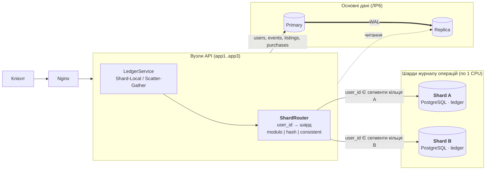

# 12. ЛР7. Масштабування даних: шардинг (Sharding)

Звіт проєкту Ticket Resale (платформа перепродажу квитків). Опис системи, ЛР1–ЛР5, запуск і розподіл відповідальності — у [README](../README.md).

Мета — розподілити набір даних, що необмежено зростає й інтенсивно записується, між незалежними вузлами СУБД. Також дослідити вплив ключа шардингу на рівномірність, Hot Shard, ціну міжшардових операцій і обсяг міграції при решардингу.

Усі демонстрації та вимірювання ЛР7 (≈ 20–25 хв):

```bash
bash scripts/lab7-run-all.sh
```

### 12.1. Вибір набору даних і ключа шардингу (Shard Key)

**Набір даних — журнал операцій користувачів `ledger_entries`.** Кожна купівля створює два записи: `BUY` для покупця і `SELL` для продавця.
- **Об'єм.** Таблиця лише зростає (append-only історія).
- **Навантаження.** Профіль — інтенсивний запис і читання історії «свого» користувача.
- **Роль даних.** Це похідні дані: джерелом істини лишається таблиця `purchases` у primary.

Основні сутності (users, events, tickets, listings, purchases) лишаються на primary + replica. Купівля змінює оголошення, квиток і запис покупки в одній ACID-транзакції. Розподіл цих сутностей між шардами перетворив би її на розподілену транзакцію (12.6).

**Ключ шардингу — `user_id`.**

| Критерій | `user_id` |
|---|---|
| **Cardinality** | Висока (тисячі–мільйони користувачів), тож дані можна рівномірно розкласти на будь-яку кількість шардів |
| **Query Locality** | Головний запит «історія операцій користувача» потрапляє на один шард (Shard-Local) |
| **Рівномірність запису** | Записи генерують багато незалежних користувачів, а не одна сутність |
| **Колізії** | Неможливі: кожен рядок має рівно одного власника |

Відкинуті варіанти:

| Ключ | Чому не підходить |
|---|---|
| Сурогатний `id` (автоінкремент) | Не пов'язаний із запитами: історія одного користувача розкидана по всіх шардах, тож кожне читання стає fan-out. Послідовності на різних шардах незалежні й видають однакові id. Тому в таблиці використано UUID (`gen_random_uuid()`), який унікальний без координації |
| `event_id` | Низька cardinality і нерівномірність: популярний концерт під час старту продажу — це «гарячий» шард (Hot Shard) саме тоді, коли навантаження найбільше |
| `created_at` (діапазони часу) | Усі нові записи потрапляють на шард поточного періоду — постійний Hot Shard для запису |

### 12.2. Архітектура (C4, рівень Container)



Кожен шард — окремий екземпляр PostgreSQL зі своєю схемою. Таблицю `ledger_entries` на кожному шарді створює застосунок під час старту міграцією Flyway з `classpath:db/shard`. Репліки шардів не розгортаються, щоб зберегти ресурси стенда; у реальній системі кожен шард мав би топологію Primary + Replica з ЛР6.

### 12.3. Shard Router

`sharding/ShardRouter` обчислює шард за ключем на рівні застосунку (Application-Level Sharding). Маршрутизація детермінована й не має стану: усі вузли API з однаковою конфігурацією спрямовують ключ на той самий шард без звернення до спільного каталогу.

| Функція (`SHARD_STRATEGY`) | Формула | Властивості |
|---|---|---|
| `modulo` | `user_id % N` | Чутлива до структури ключів (12.5); зміна N переносить ≈ N/(N+1) даних |
| `hash` | `murmur3(user_id) % N` | Рівномірна незалежно від структури ключів; зміна N так само переносить ≈ N/(N+1) |
| `consistent` (за замовчуванням) | Кільце 2^64, кожен шард — 512 віртуальних вузлів; ключ належить першому віртуальному вузлу за годинниковою стрілкою від `murmur3(user_id)` | Рівномірна; додавання шарду переносить лише ≈ 1/(N+1) ключів |

Віртуальні вузли виконують роль **Virtual Buckets**: кожен фізичний шард займає 512 розкиданих по кільцю сегментів. Це вирівнює частки шардів і дозволяє новому шарду забирати потроху ключів у кожного з наявних.

API (заголовок `X-Shard` показує, які шарди обслужили запит):

| Endpoint | Тип |
|---|---|
| `POST /api/ledger/entries` | Shard-Local запис |
| `GET /api/users/{id}/ledger` | Shard-Local читання |
| `GET /api/reports/events/{id}/sales?mode=parallel\|sequential` | Cross-Shard (Scatter-Gather) |
| `GET /api/admin/sharding`, `.../route/{key}`, `.../resharding?from=&to=` | Топологія, маршрут ключа, модель решардингу |
| `POST /api/admin/ledger/generate`, `GET /api/admin/ledger/distribution` | Генерація набору даних, матриця розподілу |

**Демонстрація детермінованості** — `scripts/lab7-routing-demo.sh`. Записи користувачів 101–106 розподіляються між шардами. SQL-запит напряму на `shard-a` і `shard-b` підтверджує, що рядки кожного користувача лежать лише на його шарді. Повторні запити того ж ключа через різні вузли API потрапляють на той самий шард.

_Вивід — `results/lab7-routing-demo.txt`._

### 12.4. Розподіл даних (Dataset Distribution Baseline)

`scripts/lab7-distribution.sh` генерує 100 000 записів для 10 000 користувачів для кожної комбінації функції маршрутизації і профілю ключів:
- `uniform` — рівномірні `user_id`;
- `even` — лише парні `user_id` (ідентифікатори з кроком 2, наприклад коли два генератори ID чергуються);
- `whale` — 50 % записів одного користувача.

_Заповнюється з `results/lab7-distribution.md`; графік — `results/lab7-distribution.svg`._

| Функція маршрутизації | Профіль ключів | Shard A, записів | Shard A, частка даних % | Shard A, частка Write Operations % | Shard B, записів | Shard B, частка даних % | Shard B, частка Write Operations % |
|---|---|---|---|---|---|---|---|
| modulo | uniform | | | | | | |
| modulo | even | | | | | | |
| modulo | whale | | | | | | |
| hash | uniform | | | | | | |
| hash | even | | | | | | |
| hash | whale | | | | | | |
| consistent | uniform | | | | | | |
| consistent | even | | | | | | |
| consistent | whale | | | | | | |


### 12.5. Hot Shard і оптимізація стратегії

`scripts/lab7-hot-shard.sh`: однакове навантаження на запис (100 VUs × 30 с, лише парні `user_id`) для `modulo` і `consistent`.
- **За `user_id % 2`** усі парні ключі потрапляють на Shard A, і він обробляє весь запис, а Shard B простоює.
- **Хеш** перемішує біти ключа, тож структура ключів перестає впливати на розподіл.

_Заповнюється з `results/lab7-hot-shard.md`; графік — `results/lab7-hot-shard.svg`._

| Функція | Записів на Shard A, % | Записів на Shard B, % | CPU Shard A | CPU Shard B | RAM Shard A | RAM Shard B | Throughput, RPS | p95, мс | p99, мс | Error Rate, % |
|---|---|---|---|---|---|---|---|---|---|---|
| modulo | | | | | | | | | | |
| consistent | | | | | | | | | | |


**Великий тенант (профіль `whale`) жодна хеш-функція не вирівнює:** усі записи одного ключа за визначенням ідуть на один шард (Hot Key). Варіанти:
- **Складений ключ** `(user_id, bucket)`, де `bucket = hash(entry_id) % K` для відомих «великих» користувачів. Запис розподіляється на K шардів, але історія такого користувача стає fan-out запитом.
- **Окремий шард** для тенанта через явну таблицю відповідності «ключ → шард» (directory-based sharding).
- **Обмеження частоти запису** для одного ключа (rate limit з ЛР2).

### 12.6. Cross-Shard операції

**Cross-Shard Query (Scatter-Gather).** Звіт продажів події (`GET /api/reports/events/{id}/sales`) не має ключа шардингу, тому виконується на кожному шарді:
1. **Scatter:** однаковий агрегатний запит `GROUP BY entry_type` на всіх шардах, паралельно на віртуальних потоках Java 21.
2. **Gather:** сервіс підсумовує часткові результати.

Ціна такого запиту:
- **Час** дорівнює найповільнішому шарду (паралельно) або сумі всіх (`mode=sequential`).
- **Ресурси:** займається по одному з'єднанню з кожним шардом, тож навантаження на кластер зростає пропорційно кількості шардів.
- **Надійність:** доступність запиту — добуток доступностей усіх шардів, тому відмова будь-якого шарду ламає весь звіт.
- **Вимоги до агрегатів:** лише ті, що коректно зливаються (count, sum, min, max). Медіану чи `DISTINCT` злити з часткових результатів неможливо.

Порівняння Shard-Local і Cross-Shard під навантаженням — у 12.8 (окремі перцентилі для кожного типу запиту).

**Cross-Shard Write.** Купівля створює `BUY` на шарді покупця і `SELL` на шарді продавця — часто це різні шарди. Локальна ACID-транзакція PostgreSQL охоплює лише один вузол, тому атомарно зафіксувати обидва записи неможливо.

| Підхід | Суть | Недоліки |
|---|---|---|
| **2PC (Two-Phase Commit)** | Координатор виконує `PREPARE TRANSACTION` на всіх шардах, потім `COMMIT PREPARED` | Блокуючий протокол: якщо координатор впав між фазами, підготовлені транзакції тримають блокування до ручного втручання; затримка — два мережеві раунди; у PostgreSQL потрібен `max_prepared_transactions > 0` |
| **Saga** | Послідовність локальних транзакцій; при збої кроку виконуються компенсуючі дії для вже виконаних | Проміжні стани видимі (немає ізоляції); компенсації треба проєктувати для кожного кроку |
| **Перепроєктований агрегат** | Дані, що змінюються разом, мають один ключ шардингу й лежать на одному шарді | Не завжди можливо (покупець і продавець — різні користувачі) |

**Обрано Saga з ідемпотентними кроками** (`LedgerService.recordPurchase`, викликається після COMMIT купівлі в primary):
1. `BUY` на шарді покупця — окрема локальна транзакція.
2. `SELL` на шарді продавця — окрема локальна транзакція.

Унікальний індекс `(purchase_id, entry_type)` робить повтор кроку безпечним (`ON CONFLICT DO NOTHING`). Компенсації не потрібні: джерело істини — `purchases` у primary, а журнал є похідною проєкцією. Пропущений крок відновлюється повторним застосуванням. У промисловій системі кроки запускаються з **Transactional Outbox**: подія записується в primary в одній транзакції з купівлею, а окремий обробник гарантовано доставляє її на шарди.

### 12.7. Модель решардингу та Consistent Hashing

При зміні кількості шардів з N на M ключ переноситься, якщо його шард змінився.
- **`key % N` → `key % (N+1)`:** ключ лишається на місці лише тоді, коли обидва залишки збігаються. Для рівномірних ключів це частка 1/(N+1), тож **переноситься N/(N+1)**: 2 → 3 — 66,7 %, 3 → 4 — 75 %, 10 → 11 — 90,9 %. Чим більший кластер, тим ближче до 100 %. `hash(key) % N` має ту саму властивість.
- **Consistent Hashing:** новий шард отримує свої віртуальні вузли на кільці й забирає лише ключі, що потрапили в їхні сегменти. **Переноситься ≈ 1/(N+1)** (2 → 3 — 33,3 %, 10 → 11 — 9,1 %). Решта ключів лишається на місці. 512 віртуальних вузлів на шард вирівнюють частки (на 100 000 послідовних ключів частки двох шардів: 52,9 / 47,1 % за 128 віртуальних вузлів і 51,2 / 48,8 % за 512): без них кожен шард мав би один випадковий сегмент кільця, і частки могли б відрізнятися в рази.

`GET /api/admin/sharding/resharding?from=N&to=M&keys=100000` обчислює частку перенесених ключів для всіх трьох функцій тими самими класами, що й маршрутизатор.

_Заповнюється з `results/lab7-routing-demo.txt`._

| Зміна | modulo, % перенесених | hash, % перенесених | consistent, % перенесених | Мінімально можливо, % |
|---|---|---|---|---|
| 2 → 3 | | | | 33,3 |
| 3 → 4 | | | | 25,0 |
| 10 → 11 | | | | 9,1 |

### 12.8. Performance Benchmark: Single Node проти Sharded Cluster

`scripts/lab7-benchmark.sh`: змішане навантаження (50 % запис, 35 % Shard-Local читання, 15 % Cross-Shard звіт) на однаковому наборі даних (100 000 записів, 10 000 користувачів), ступені 25 → 50 → 100 → 200 VUs по 30 с.

| Топологія | `SHARD_URLS` |
|---|---|
| Single Node | лише `shard-a` (1 CPU) |
| Sharded | `shard-a` + `shard-b` (по 1 CPU), Consistent Hashing |

_Заповнюється з `results/lab7-benchmark.md`; графіки — `results/lab7-benchmark-{single,sharded}-latency.svg`._

| Топологія | VUs | Throughput, RPS | Запис p95 / p99, мс | Shard-Local p95 / p99, мс | Cross-Shard p95 / p99, мс | Error Rate, % |
|---|---|---|---|---|---|---|
| Single Node | 25 | | | | | |
| Single Node | 50 | | | | | |
| Single Node | 100 | | | | | |
| Single Node | 200 | | | | | |
| Sharded | 25 | | | | | |
| Sharded | 50 | | | | | |
| Sharded | 100 | | | | | |
| Sharded | 200 | | | | | |

### 12.9. Теоретичні питання

**Партиціювання, шардинг і реплікація.**
- **Партиціювання** — поділ таблиці на частини за ключем у межах одного сервера СУБД (`PARTITION BY RANGE / LIST / HASH` у PostgreSQL). Прискорює запити й обслуговування (видалення старих партицій), але ресурси сервера ті самі.
- **Шардинг** — горизонтальне партиціювання між різними серверами: кожен шард має свої CPU, пам'ять і диск, тому масштабуються і запис, і обсяг даних.
- **Реплікація** — копії тих самих даних на кількох вузлах: масштабує читання і дає відмовостійкість, але кожна репліка зберігає весь набір і отримує весь потік записів.

Підходи поєднуються: кожен шард зазвичай має репліки.

**Distributed JOIN.** JOIN між таблицями з різними ключами шардингу неможливо виконати одним SQL-запитом: дані лежать на різних серверах. Варіанти:
- fan-out з об'єднанням у застосунку (дорого);
- денормалізація (у `ledger_entries` збережено `event_id` і суму, щоб не звертатися до `events`);
- co-location: пов'язані таблиці шардуються за тим самим ключем;
- reference-таблиці, повністю скопійовані на кожен шард.

**Unique constraints.** Унікальний індекс діє лише в межах одного шарду. Глобальна унікальність потребує:
- щоб ключ шардингу був частиною унікального ключа (тоді дублікати потрапляють на той самий шард);
- або окремого глобального реєстру (lookup-таблиця, Redis `SET NX`);
- або ідентифікаторів, унікальних без координації (UUID, Snowflake).

**2PC і Saga** — 12.6.

**Consistent Hashing** — 12.7: простір хешів розглядається як кільце, вузли й ключі розміщуються на ньому однією хеш-функцією, ключ належить найближчому вузлу за годинниковою стрілкою. Зміна складу кластера зачіпає лише сусідні сегменти, а віртуальні вузли вирівнюють навантаження.
