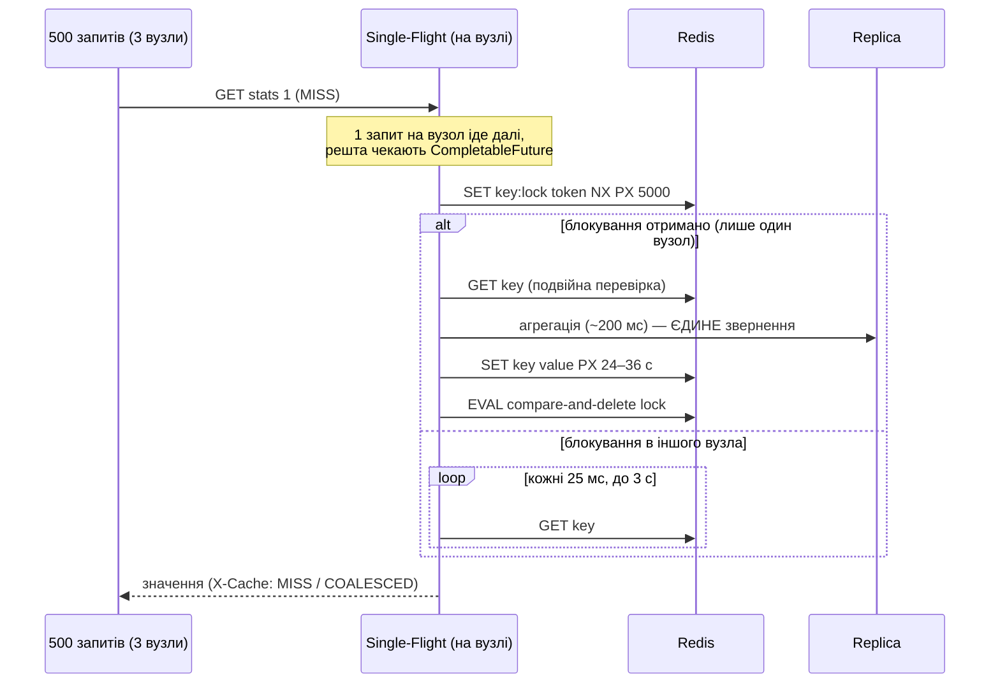

# 13. ЛР8. Інженерія стійкості: Cache Stampede, Thundering Herd, Cache Avalanche, Cache Penetration

Звіт проєкту Ticket Resale (платформа перепродажу квитків). Опис системи, ЛР1–ЛР5, запуск і розподіл відповідальності — у [README](../README.md).

Мета — відтворити лавинні навантаження на СУБД у моменти відсутності даних у кеші, кількісно оцінити їх і впровадити механізми координації запитів та захисту від запитів до неіснуючих сутностей.

Усі експерименти ЛР8 (≈ 15–20 хв):

```bash
bash scripts/lab8-run-all.sh
```

### 13.1. Ресурсоємний кешований об'єкт

**`GET /api/events/{id}/stats`** — агрегована статистика події:
- кількість активних оголошень, мінімальна, середня й максимальна ціна;
- кількість проданих квитків і виручка.

Чому цей ресурс критичний:
- **Популярність.** Статистику показує сторінка події, тож під час старту перепродажу популярного концерту (піковий сценарій з розділу 5 [README](../README.md#5-піковий-сценарій-навантаження-high-load-scenario)) її одночасно запитують сотні клієнтів.
- **Вартість.** Агрегати по `listings` і `purchases`, причому для `purchases` немає індексу за `event_id` — повний перегляд таблиці (після ЛР5 у ній десятки тисяч рядків).
- **Наслідки промаху.** Кожен Cache Miss займає з'єднання пулу (10 на вузол) на весь час агрегації. Сотня одночасних промахів вичерпує всі пули і блокує навіть дешеві запити.

На лабораторному наборі даних агрегація виконується за мілісекунди, тому її тривалість збільшено синтетично. Після агрегації в тій самій транзакції виконується `pg_sleep(STATS_QUERY_COST)` (200 мс за замовчуванням), що моделює коштовний аналітичний запит. Затримка відбувається саме в СУБД і утримує з'єднання, як справжній важкий запит.

Статистика допускає узгодженість у кінцевому підсумку, тому читається з репліки (ЛР6). Кешується в Redis з ключем `resale:stats:event:{id}` і TTL 30 с ± 20 %.

### 13.2. Методика вимірювань

- **Звернення до СУБД** рахуються в Redis (`resale:metrics:stats:db_loads`, сумарно для всіх вузлів API): кожен виклик агрегації збільшує лічильник. Додатково фіксується кількість транзакцій репліки (`pg_stat_database`) і CPU контейнера репліки.
- **Режими** перемикаються змінними оточення без зміни коду; скрипти перестворюють вузли API:

| Змінна | Значення | Призначення |
|---|---|---|
| `STATS_PROTECTION` | `none` / `lock` | Без координації / Single-Flight + Distributed Lock |
| `STATS_TTL_JITTER` | `0` / `0.2` | Синхронне закінчення TTL / ±20 % |
| `NEGATIVE_CACHE` | `false` / `true` | Захист від Cache Penetration |
| `STATS_TTL`, `STATS_QUERY_COST` | `30s`, `200ms` | TTL і «вартість» агрегації |

- **Службові endpoint-и** (лише для стенда):
  - `GET /api/admin/stats-cache` — лічильники й поточний режим;
  - `POST /api/admin/stats-cache/reset` — холодний кеш;
  - `POST /api/admin/stats-cache/evict/{id}` — Force Expire одного ключа.
- **Заголовок `X-Cache`** показує джерело відповіді:
  - `HIT` — з кешу;
  - `MISS` — цей запит звертався до СУБД;
  - `COALESCED` — запит дочекався результату іншого запиту;
  - `BYPASS` — Redis недоступний.

### 13.3. Відтворення Cache Stampede / Thundering Herd

`scripts/lab8-stampede.sh` → `load-tests/lab8-stampede.js`:
1. Кеш і лічильники скидаються: ключ події 1 холодний.
2. Розігрів 20 VUs × 10 с на іншій події (JIT, пули з'єднань).
3. **500 VUs одночасно** протягом 15 с читають статистику події 1.
4. Кількість звернень до СУБД = лічильник після атаки − лічильник перед атакою.

Без захисту кожен запит, що прийшов до появи ключа в Redis, сам виконує агрегацію (**Cache Stampede**). Сотні однакових запитів одночасно надходять у СУБД (**Thundering Herd**). Пули з'єднань вичерпуються, черга зростає, і частина запитів завершується тайм-аутом.

Скрипт записує результат обох режимів у `results/lab8-stampede.md` і графіки `results/lab8-stampede-db-loads.svg`, `results/lab8-stampede-p99.svg`; очікувані значення — у 13.7.

### 13.4. Захист: Single-Flight + Distributed Lock

`cache/StatsCache`, режим `lock` — дворівнева координація:

1. **Single-Flight (Request Coalescing) у межах екземпляра.** Перший запит ключа реєструє `CompletableFuture` у `ConcurrentHashMap`; паралельні запити того ж ключа на цьому вузлі чекають на нього. З одного вузла до Redis і СУБД іде лише один запит.
2. **Distributed Lock між екземплярами.**
   - Блокування береться командою `SET resale:stats:event:{id}:lock <token> NX PX 5000`.
   - Власник блокування ще раз перевіряє кеш (значення міг записати інший вузол), виконує агрегацію і записує результат.
   - Інші вузли кожні 25 мс читають кеш, доки значення не з'явиться.
   - Блокування знімає Lua-скрипт лише за збігу токена: вузол, чиє блокування вже закінчилося, не може зняти чуже.



**Обробка тайм-аутів:**
- Блокування живе 5 с (`lock-ttl`) — значно довше за агрегацію (200 мс). Водночас якщо власник впав або завис, блокування зникне саме: «вічних» блокувань і взаємоблокувань (deadlock) немає. Кожен запит бере не більше одного блокування.
- Очікувач чекає до 3 с (`lock-wait`). Після цього він отримує **503 з `Retry-After: 1`**, а не йде в СУБД сам: інакше після тайм-ауту всі очікувачі одночасно повторили б Stampede.

_Порівняльна матриця — 13.7._

### 13.5. Cache Avalanche і TTL Jittering

`scripts/lab8-avalanche.sh` → `load-tests/lab8-avalanche.js`:
1. 50 ключів статистики створюються **в одну секунду** (одночасний прогрів через `http.batch`).
2. TTL — 10 с.
3. 100 VUs × 60 с читають випадкові події.
4. Щосекунди фіксується приріст звернень до СУБД і p95 затримки.

Результат порівнюється для двох режимів:
- **`STATS_TTL_JITTER=0`** — усі 50 ключів зникають в одну секунду. Кожні ~10 с виникає хвиля з 50 звернень до СУБД і сплеск затримки (**Cache Avalanche**). Після перезавантаження ключі знову синхронні, тож хвилі повторюються.
- **`STATS_TTL_JITTER=0.2`** — `TTL = 10 с × (1 ± 0,2)`, тобто 8–12 с. Закінчення розподіляються в часі, і з кожним циклом розкид зростає.

Скрипт записує підсумки обох режимів у `results/lab8-avalanche.md`, а часові ряди — у графіки нижче.

**Очікуваний результат (гіпотеза до вимірювання).** Перезавантаження ключа захищене блокуванням, тож на кожен ключ за одне закінчення TTL припадає одне звернення до СУБД. За 60 с при TTL 10 с це ≈ 50 ключів × 6 циклів ≈ 300 звернень в обох режимах.
- **Без jitter:** звернення приходять хвилями по ~50 за 1–2 секунди кожні ~10 с, і саме в ці секунди зростає p95.
- **З jitter:** та сама кількість звернень розмазана по часу, тому пік за секунду має знизитися в кілька разів, а графік p95 — стати рівнішим.


Jitter не зменшує загальну кількість звернень, бо кожен ключ однаково перезавантажується раз на TTL. Він розподіляє їх у часі й знижує пікове навантаження на СУБД. Те саме правило TTL ± 20 % діє для кешу оголошень з ЛР4.

### 13.6. Cache Penetration і Negative Caching

`scripts/lab8-penetration.sh` → `load-tests/lab8-penetration.js`: 100 VUs × 20 с запитують статистику 200 різних **неіснуючих** подій (id 9 000 001 … 9 000 200).
- **Без Negative Caching:** відповідь «не існує» не кешується, тож кожен запит проходить крізь кеш у СУБД.
- **З Negative Caching:** для неіснуючої події зберігається маркер `__NOT_FOUND__` з коротким TTL (15 с). Повторні запити отримують 404 з кешу (`X-Cache: HIT`). До СУБД доходить приблизно один запит на id за TTL.

Скрипт записує результат у `results/lab8-penetration.md`.

**Очікуваний результат (гіпотеза до вимірювання).**
- **Без Negative Caching** до СУБД доходить кожен із запитів, тобто кількість звернень дорівнює кількості запитів: тисячі за 20 с.
- **З Negative Caching (TTL 15 с)** кожен із 200 id звертається до СУБД один раз за TTL. За 20 с тесту це не більше ≈ 200 × 2 = 400 звернень, тобто менше 10 % запитів, а решта отримує 404 з Redis (`X-Cache: HIT`). Затримка таких відповідей має відповідати HIT (одиниці–десятки мс), а не запиту до бази.

**Обмеження.** Negative Caching захищає від повторних запитів до тих самих неіснуючих id. Атака з кожного разу новими випадковими id (9 000 001, 9 000 002, …) обходить його: кожен id запитується вперше. Від такої атаки захищає **Bloom Filter** — компактна ймовірнісна структура з усіма наявними id:
- Відповідь «точно немає» дозволяє не звертатися ні до кешу, ні до СУБД.
- Хибно-позитивні відповіді можливі з заданою ймовірністю й лише призводять до зайвого запиту.
- Хибно-негативних немає.

Bloom Filter потребує модуля RedisBloom або фільтра в пам'яті з оновленням при кожному створенні події, тому в стенді не реалізований.

### 13.7. Порівняльна матриця: Unprotected проти Protected

Фактичні значення обох режимів скрипт `scripts/lab8-stampede.sh` записує в `results/lab8-stampede.md` (500 VUs одночасно, один холодний ключ).

**Очікуваний результат (гіпотеза до вимірювання).**

| Режим / Показник | Кількість запитів до СУБД | Throughput (RPS) | p95 / p99 Latency | Error Rate (%) |
|---|---|---|---|---|
| Unprotected (Stampede) | Сотні: кожен запит, що прийшов до появи ключа | Нижчий: пули з'єднань зайняті однаковою агрегацією | Секунди: черга до 3 × 10 з'єднань репліки × 200 мс на запит | > 0: тайм-аут очікування з'єднання (2 с) |
| Protected (Coalescing / Lock) | **1** | Вищий: після першого завантаження всі запити — HIT | Перші запити чекають одне завантаження (~200–300 мс), далі як HIT | ≈ 0 |

Обґрунтування оцінки для режиму без захисту:
- **Пропускна здатність завантажень.** 500 одночасних промахів, кожен утримує з'єднання 200 мс, а з'єднань 30 (3 вузли × 10). Отже, СУБД обробляє ≈ 150 завантажень за секунду.
- **Наслідок.** Черга розсмоктується ≈ 3 с, тож частина запитів не дочекається з'єднання за 2 с і завершиться помилкою.

### 13.8. Failure Modes Analysis — ризики самих механізмів захисту

| Механізм | Ризик | Наслідок | Як обмежено |
|---|---|---|---|
| Distributed Lock | Власник блокування впав або завис | Інші вузли чекають, ключ не оновлюється | `PX 5000`: блокування зникає саме; очікувачі після 3 с отримують 503, а не перевантажують СУБД |
| Distributed Lock | Агрегація триває довше за `lock-ttl` | Блокування зникає, другий вузол також починає агрегацію — два звернення замість одного | `lock-ttl` (5 с) ≫ тривалості агрегації (200 мс); токен не дає зняти чуже блокування. Повну гарантію дає fencing token, який перевіряє саме сховище |
| Distributed Lock | Deadlock | — | Неможливий: один запит тримає не більше одного блокування, і воно має TTL |
| Distributed Lock | Redis недоступний | Координації немає (BYPASS): за великої кількості запитів можливий Stampede | Свідомий вибір доступності над захистом; пули HikariCP обмежують паралелізм до 3 × 10 з'єднань |
| Distributed Lock | Redis з реплікацією | Блокування втрачається при перемиканні майстра Redis до реплікації ключа | Для кешу допустимо (у гіршому разі — дубль завантаження). Redlock (13.10) зменшує ризик, але не прибирає його повністю |
| Single-Flight | Помилка або тайм-аут лідера | Усі очікувачі на вузлі отримують ту саму помилку | Тайм-аут очікування `lock-wait + 2 с`; запис видаляється з мапи у `finally` |
| Single-Flight | Пам'ять | Один `CompletableFuture` на ключ, що зараз завантажується | Обсяг обмежений кількістю одночасно холодних ключів, записи видаляються одразу після завантаження |
| TTL Jitter | Частина ключів живе довше за базовий TTL | Застарілість до +20 % (36 с замість 30 с) | Допустимо для аналітики |
| Negative Caching | Подія створена після кешування «не існує» | 404 для нової події до 15 с | Короткий TTL. ID нових подій видає послідовність, тож збіг з раніше запитаним неіснуючим id малоймовірний |
| Negative Caching | Пам'ять Redis під маркери | Атака з мільйонами різних id заповнює Redis | Короткий TTL; `maxmemory 256mb` + `volatile-lru` витісняє маркери першими; проти такої атаки потрібен Bloom Filter |
| Stale-While-Revalidate (не реалізовано) | — | Віддає застаріле значення під час оновлення | Альтернатива блокуванню: без очікувань, але з застарілими даними до завершення фонового оновлення |

### 13.9. Resilience Profile системи (ЛР2–ЛР8)

| Загроза | Механізм | Де | Залишковий ризик |
|---|---|---|---|
| Втрата вузла API | Stateless-вузли, пасивний health check і повтор запиту в Nginx | ЛР2, ЛР3 | Сплеск затримки до ~2,5 с у момент відмови |
| Повільний вузол API | Least Connections | ЛР3 | — |
| Nginx як SPOF | — (у стенді один балансувальник) | ЛР3, 8.5 | Keepalived / VRRP у промисловій системі |
| Перевантаження БД читаннями | Кеш Cache-Aside, read replica | ЛР4, ЛР6 | Застарілість до TTL / Replication Lag |
| Відмова Redis | BYPASS кешу, fail-open rate limit, купівля без перевірки бронювання | ЛР4 | Бронювання недоступне (503); без координації кешу можливий Stampede |
| Відмова репліки | Primary Fallback | ЛР6 | Навантаження читань повертається на primary |
| Відмова primary | Режим лише читання | ЛР6 | Запис недоступний до ручного promote |
| Stale Read після запису | Sticky Routing, Explicit Primary, наповнення кешу з primary | ЛР6 | Lag довший за TTL мітки (10 с) |
| Hot Shard | Consistent Hashing з віртуальними вузлами | ЛР7 | Великий тенант (Hot Key) |
| Часткова відмова Cross-Shard запису | Ідемпотентні кроки Saga, джерело істини в primary | ЛР7 | Тимчасова неповнота журналу |
| Cache Stampede / Thundering Herd | Single-Flight + Distributed Lock | ЛР8 | Без Redis координації немає |
| Cache Avalanche | TTL Jitter ± 20 % | ЛР4, ЛР8 | — |
| Cache Penetration | Negative Caching | ЛР8 | Випадкові нові id (потрібен Bloom Filter) |
| Боти, масове скуповування | Rate limit 20/хв, ліміт 4 квитки на подію | ЛР1, ЛР2 | — |

### 13.10. Теоретичні питання

**Cache Stampede, Thundering Herd, Cache Avalanche, Cache Penetration.**
- **Cache Stampede** — один популярний ключ зникає (TTL, інвалідація), і багато паралельних запитів одночасно виявляють промах і запускають однакове коштовне обчислення.
- **Thundering Herd** — загальніше явище: велика кількість клієнтів, що чекали на одну подію (звільнення ресурсу, повернення сервісу, промах кешу), прокидається одночасно й навалюється на один ресурс. Cache Stampede — його окремий випадок для кешу.
- **Cache Avalanche** — одночасно зникає велика **група** різних ключів: однаковий TTL після прогріву, перезапуск або очищення Redis. Навантаження надходить на СУБД широким фронтом, а не на один запит.
- **Cache Penetration** — запити до даних, яких немає ні в кеші, ні в СУБД. Кеш їх ніколи не зберігає, тож кожен такий запит пробиває його до СУБД. Часто це атака.

**Redlock.** Алгоритм розподіленого блокування Redis на N (зазвичай 5) незалежних майстрах:
1. Клієнт по черзі намагається взяти блокування `SET key token NX PX ttl` на всіх вузлах.
2. Блокування вважається отриманим, якщо воно встановлене на більшості (≥ N/2 + 1) вузлів і сумарний час отримання менший за TTL.
3. Інакше клієнт знімає блокування на всіх вузлах.

Redlock стійкий до відмови окремих вузлів Redis. Проте він спирається на припущення про обмежені паузи процесів і дрейф годинника: пауза GC довша за TTL може призвести до двох власників. Тому для коректності (а не лише ефективності) потрібні fencing tokens. У стенді використано одне блокування на одному Redis: воно захищає ефективність (одне звернення замість сотень), а не коректність даних.

**Bloom Filter** — бітовий масив розміру m і k хеш-функцій.
- **Додавання** елемента встановлює k бітів.
- **Перевірка:** якщо хоча б один із k бітів дорівнює 0, елемента точно немає; якщо всі 1 — елемент можливо є.
- **Ймовірність хибно-позитивної відповіді** ≈ (1 − e^(−kn/m))^k. Для 1 % потрібно ≈ 9,6 біта на елемент.
- **Обмеження:** видалення елементів неможливе без Counting Bloom Filter.

Застосовується перед кешем для відсікання запитів до неіснуючих ключів (13.6).

**Probabilistic Early Expiration (XFetch).** Запис оновлюється не в момент закінчення TTL, а трохи раніше, з імовірністю, що зростає до кінця TTL. Кожен запит перевіряє умову `now − delta · β · ln(rand()) ≥ expiry`, де delta — тривалість останнього обчислення, β ≥ 1 — коефіцієнт агресивності. Чим ближче закінчення і чим дорожче обчислення, тим імовірніше, що один із запитів завчасно перебудує значення. Решта в цей час отримує ще актуальний запис. Stampede не виникає без жодних блокувань, ціна — інколи зайве завчасне обчислення.
